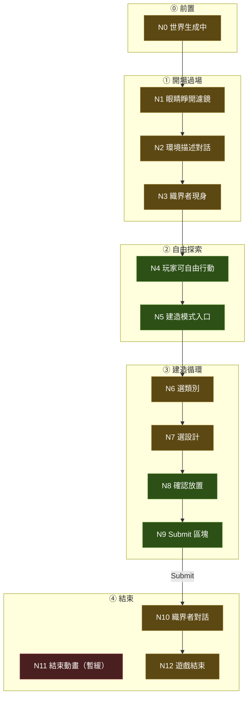
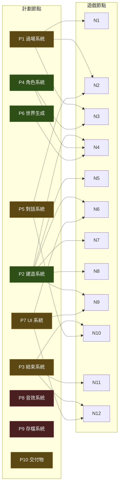

# FLOWCHART — Mermaid 備份

> 這是 [[CIS428 計劃看板.canvas]] 的純文字備份，方便在 VS Code 快速預覽。
> 在 VS Code 按 `Ctrl+Shift+V` 開啟預覽。

## 遊戲流程

## 計劃層對應

## 節點索引

### 遊戲流程節點

| ID | 名稱 | 狀態 |
|---|---|---|
| N0 | [[N0 世界生成中]] | 🟡 |
| N1 | [[N1 眼睛睜開濾鏡]] | 🟡 |
| N2 | [[N2 環境描述對話]] | 🟡 |
| N3 | [[N3 織界者現身]] | 🟡 |
| N4 | [[N4 玩家可自由行動]] | 🟢 |
| N5 | [[N5 建造模式入口]] | 🟢 |
| N6 | [[N6 選類別]] | 🟢 |
| N7 | [[N7 選設計]] | 🟡 |
| N8 | [[N8 確認放置]] | 🟢 |
| N9 | [[N9 Submit 區塊]] | 🟢 |
| N10 | [[N10 織界者對話]] | 🟡 |
| N11 | [[N11 結束動畫]] | ⏸️ |
| N12 | [[N12 遊戲結束]] | 🟡 |

### 計劃節點

| ID | 名稱 | 狀態 |
|---|---|---|
| P1 | [[P1 過場系統]] | 🟡 |
| P2 | [[P2 建造系統]] | 🟢 |
| P3 | [[P3 結束系統]] | 🟡 |
| P4 | [[P4 角色系統]] | 🟢 |
| P5 | [[P5 對話系統]] | 🟡 |
| P6 | [[P6 世界生成]] | 🟢 |
| P7 | [[P7 UI 系統]] | 🟡 |
| P8 | [[P8 音效系統]] | ⏸️ |
| P9 | [[P9 存檔系統]] | ⏸️ |
| P10 | [[P10 交付物]] | 🟡 |