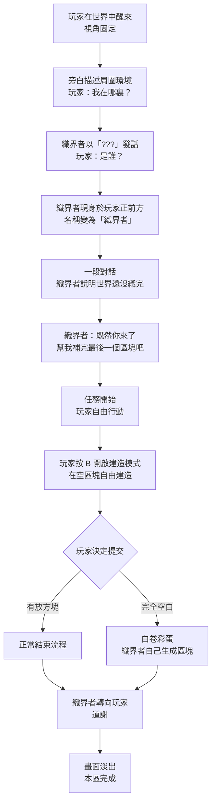

# 織界者 The Loomkeeper

CIS428 Metaverse Technology — Assignment 2
原創角色 IP 設計文件

---

## 1. 總覽

| 項目                   | 內容                                                           |
| ---------------------- | -------------------------------------------------------------- |
| **既有 IP**      | Minecraft                                                      |
| **原創角色**     | 織界者 / The Loomkeeper                                        |
| **角色定位**     | 引導者（Guide）——生成世界的存在                              |
| **核心 What-if** | 如果世界生成不是隨機的，而是由一個有意識的存在決定的，會怎樣？ |
| **體驗類型**     | 互動任務——協助織界者補完最後一個未生成的區塊                 |

---

## 2. What-if 問題

Minecraft 的世界是無限且程序化生成的。每當玩家往前走，新的地形就會出現——山脈、海洋、洞穴、埋在地下的鑽石。但遊戲從未解釋**是誰、或什麼東西，決定了要生成什麼**。

織界者就是這個沉默的答案。

> **如果世界生成系統有意識——而且它已經累壞了，會怎樣？**

這是一個*創意 what-if 延伸*：它不違背任何官方 Minecraft 設定，因為官方設定從未觸及這個問題。它只是填補了一個一直存在的空白。

---

## 3. 角色設計

### 3.1 名稱

**織界者**（The Loomkeeper）

中文名用「織」而非「創造」，因為好聽。 沒有其他原因。

### 3.2 外觀設計

| 部位               | 設計                                                           | 理由         |
| ------------------ | -------------------------------------------------------------- | ------------ |
| **整體輪廓** | 上半身正常，下半身逐漸解體成散落的漂浮方塊                     | 好看         |
| **頭部**     | 沒有臉，只有一個藍色發光的方塊核心                             | 好看         |
| **身體材質** | 由不同生態域的方塊拼成——肩膀是石頭、胸口是草方塊、手臂是砂岩 | 好看         |
| **下半身**   | 從腰部開始逐漸變成漂浮的方塊碎片，越往下越稀疏                 | 好看         |
| **手部**     | 細長，像織布機的梭子，指尖有粒子效果                           | 好看         |
| **配色**     | 深灰（石頭）＋ 螢光藍（核心）＋ 生態域點綴色                   | 冷色調，好看 |

**建模提醒**：下半身的「解體」效果必須用**分離的方塊物件**製作，不能做成一體成形的網格，否則在 VoxEdit 裡無法表現漂浮／飄散動畫。

**參考圖**：本節的視覺描述已轉為生圖 prompt，見 [`reference_image_prompts.md`](./reference_image_prompts.md)。產出的圖存於 [`images/`](./images/)。

### 3.3 個性

**過勞的同事，不是神明。**

織界者說話簡短、務實，沒有儀式感。他不解釋自己是誰，也不覺得需要解釋——對他來說，世界生成就是一份工作，而他是唯一在做這份工作的人。

| 特質 | 表現方式 |
| --- | --- |
| **務實** | 不講場面話。玩家問「你是誰」，他答「我在忙」 |
| **疲憊** | 句子短、停頓多、省略主語。不是不耐煩，是真的沒力氣 |
| **不居功** | 玩家幫完忙，他只說「好了。謝謝。」——像同事交接，不像救世主 |
| **乾式幽默** | 偶爾一句自嘲，語氣平淡，不刻意搞笑 |
| **對玩家沒有期待** | 不指派任務、不給獎勵、不評價成果。玩家做什麼他都接受 |

**關鍵台詞語氣**：

> 「⋯⋯你來得有點早。」
>
> 「不過既然來了，幫個忙吧。我一個人編不完。」

這兩句定調了整個角色：**他不會求人，只是陳述事實**。玩家幫不幫，他都不會多說一句。

**他不會做的事**：

- 不會長篇解釋世界觀
- 不會稱讚玩家「你是被選中的人」
- 不會威脅或催促
- 不會在玩家失敗時責備（白卷彩蛋也只是溫和調侃）

### 3.4 背景故事

> 織界者不是被創造出來的。他**就是**生成機制本身。
>
> 當第一個世界被生成時，他就已經存在了。他的工作是決定每一格方塊該是什麼——山脈在哪裡升起、海洋在哪裡鋪開、鑽石埋在哪裡。這份工作沒有終點，因為世界是無限的。
>
> 他曾經記得每一個他織過的世界。現在他記不得了，因為太多了。他只知道，每當有玩家進入世界，他就必須繼續織下去——因為玩家會往前走，而前方必須有路。
>
> 他從未見過自己織出的世界。他只能從玩家的行為推測：如果玩家在那裡蓋了房子，那裡大概是個好地方；如果玩家在那裡死了，那裡大概很危險。
>
> 他不孤獨。他只是很忙。

### 3.5 與 Minecraft 的關聯

| Minecraft 元素 | 角色的連結方式 |
| --- | --- |
| **世界生成** | 角色所體現的核心機制——官方設定從未解釋誰在生成世界 |
| **生態域（Biome）** | 他的身體由生態域方塊組成，直接對應遊戲的生態域系統 |
| **區塊（Chunk）** | 他的工作單位就是區塊。玩家要補完的「最後一個區塊」是 Minecraft 世界的最小生成單位 |
| **方塊（Block）** | 他的下半身解體成漂浮方塊——方塊是 Minecraft 的原子，也是他身體的原子 |
| **虛空（Void）** | 未生成的區域露出虛空。這是 Minecraft 玩家都懂的視覺語言：虛空＝世界還沒完成 |
| **創造模式（Creative Mode）** | 玩家在建造模式中獲得的能力（飛行、無限方塊、瞬間破壞）對應 Minecraft 的創造模式 |
| **種子碼（Seed）** | 世界生成由種子決定，但種子從何而來從未解釋——織界者就是那個「決定種子的人」 |

---

## 4. 互動體驗

### 4.1 前提

玩家在**世界生成完成之前**進入世界。這不是異世界，也不是傳送門——玩家只是早到了一步。地形還在成形：方塊漂浮在半空中，地面殘缺不全，虛空從缺口透出來。

織界者就在那裡，正在編織。他注意到玩家。

> 「⋯⋯你來得有點早。」
>
> 「不過既然來了，幫個忙吧。我一個人編不完。」

### 4.2 劇情流程



**與舊版的差異**：舊版流程是「左右切換造型 → 中間確認 → 所有類別都確認才結束」，那是 TSB GameMaker 時代的設計（GameMaker 無法自由放置方塊，只能用 Switcher 切換預設造型）。

TSB Studio 可以自由建造，所以流程改為 **Minecraft 式**：玩家在空區塊自由放置／破壞方塊，隨時可以 Submit。沒有「必須完成所有類別」的硬性條件。

| 項目 | 舊版（GameMaker） | 新版（TSB Studio） |
| --- | --- | --- |
| 建造方式 | 左右切換預設造型 | 自由放置／破壞方塊 |
| 完成條件 | 所有類別都確認 | 無——隨時可 Submit |
| 類別 | 必須完成 3 個 | 只是預設設計的分類，不強制 |
| 空白提交 | 不可能 | 白卷彩蛋 |

### 4.3 核心循環

```
玩家走進未完成的區塊
    ↓
觀察：這裡缺什麼？（地形、結構、裝飾）
    ↓
按 B 進入建造模式
    ↓
┌─ 第一人稱：準心對準方塊，5 格距離
└─ 上帝視角：滑鼠游標選格，角色留在原地
    ↓
左鍵破壞 / 右鍵放置
    ↓
（可選）從預設設計庫挑一個起點，再整體移動／旋轉
    ↓
隨時可 Undo / Redo
    ↓
滿意了 → 按 Ctrl+Enter 提交
    ↓
織界者轉向玩家，道謝
    ↓
畫面淡出 → 本區完成
```

**與舊版的差異**：舊版寫「走近選擇台 → 按 E 互動 → 左右切換造型 → 確認」，那是 GameMaker 時代的做法——GameMaker 沒有物品欄、不能放置方塊，所以只能讓玩家「挑選預設造型」。

TSB Studio 可以真正放置方塊，所以核心循環回到 **Minecraft 原生玩法**：觀察 → 建造 → 提交。

| 項目 | 舊版（GameMaker） | 新版（TSB Studio） |
| --- | --- | --- |
| 互動方式 | 走近選擇台按 E | 直接對世界放置／破壞 |
| 決定方式 | 左右切換造型 | 自由建造，或套用預設再調整 |
| 視角 | 固定第一人稱 | 第一人稱 + 上帝視角 |
| 撤銷 | 無 | Undo / Redo |
| 完成判定 | 所有類別確認 | 玩家主動 Submit |

**這個改動讓角色更貼合**：織界者不是要玩家當工人搬方塊，而是把「決定這塊地長什麼樣」的權力交給玩家。他累到連選擇都做不了了——所以玩家不是替他執行，是替他決定。

### 4.4 範圍

**一個可編輯區塊，四周是單層的不可編輯地形。**

| 項目 | 數值 |
| --- | --- |
| 可編輯區塊 | **1 個**（16 × 16 格） |
| 可編輯高度 | Y = 0 ~ 255 |
| 地表層 | Y = 10（地面頂部世界 Y = 11） |
| 地面下方 | Y = 0 ~ 9，共 10 層泥土／石頭 |
| 周圍地形 | **9 × 9 個 chunk**（144 × 144 格） |
| 周圍地形高度 | **只有單層**，且**不可破壞／不可放置** |
| 方塊尺寸 | 1 方塊 = 1 公尺 |
| Chunk 尺寸 | 1 chunk = 16 × 16 方塊（X/Z 平面） |

**為什麼地表在 Y = 10 而不是 0**：如果地表就在世界最低層（Y = 0），地面只有一層方塊，下面直接是虛空——玩家往下挖一格就會掉出去。留 10 層泥土在下面，地面才有厚度，挖起來才像 Minecraft。

**為什麼周圍只做單層**：

| 理由 | 說明 |
| --- | --- |
| **效能** | 9 × 9 = 81 個 chunk，若全部做滿高度（256 層）會有 530 萬個方塊 |
| **視覺足夠** | 玩家站在可編輯區塊內，周圍只需要「看起來有地面延伸到地平線」 |
| **霧遮蔽** | 遠處由霧淡出，看不到邊界 |
| **聚焦** | 玩家一眼就知道「只有中間這塊是我的」 |

**可編輯 vs 不可編輯的界線**：

| 區域 | 可放置 | 可破壞 | 說明 |
| --- | --- | --- | --- |
| 中央 16 × 16 | ✅ | ✅ | 玩家的畫布 |
| 周圍 144 × 144 | ❌ | ❌ | 只是佈景，讓世界看起來完整 |

玩家嘗試在不可編輯區放置時，選取框變紅並提示「超出可建造範圍」。

**為什麼不做多區塊**：2–4 分鐘的錄影，一個區塊的完整流程（觀察 → 建造 → 提交 → 道謝）剛好夠。多區塊會稀釋敘事密度，也增加實作風險。

### 4.5 結局

玩家按下 Submit。織界者轉過身來，第一次正面對著玩家——他之前一直背對著，望著那個空缺。

> 「⋯⋯好了。」
>
> 「比我預期的快。謝謝。」

簡短地，像個同事，而不是救世主。畫面淡出，本區完成。

沒有轉折，沒有隱藏的謎團。玩家只是幫了一個進度落後的人做完他做不完的最後一件事。

**白卷彩蛋**：如果玩家提交時區塊內一個方塊都沒有，織界者會沉默一下，然後說：

> 「⋯⋯」
>
> 「既然你想不到，那我就自己弄了。」
>
> 「看著吧。」

接著他會自己生成一個區塊——方塊由下往上、由內往外逐格出現，約 3–5 秒。語氣是溫和調侃，不是責備。然後同樣進入道謝與淡出。

**為什麼要有白卷彩蛋**：Submit 沒有最低要求，所以「什麼都不做」是合法選項。與其讓玩家看到一個空蕩蕩的結束畫面，不如讓織界者接手——這既符合他的個性（務實、不抱怨），也讓「不建造」變成一個有內容的結局，而不是失敗。

---

## 5. 為什麼這個設計符合作業要求

| 作業要求                     | 本設計如何滿足                                                                     |
| ---------------------------- | ---------------------------------------------------------------------------------- |
| **原創角色 IP**        | 織界者完全原創——不是任何既有 Minecraft 角色的複製或換色                          |
| **與既有 IP 的關聯**   | 直接建立在 Minecraft 的世界生成機制上；任何玩家一看就懂                            |
| **Natural extension**  | 像是遊戲「本來就該解釋、卻從未解釋」的東西                                         |
| **Creative "what-if"** | 「如果生成機制有意識」是一個明確的 what-if                                         |
| **互動體驗** | 明確的任務流程：觀察 → 建造 → 提交 → 道謝 |
| **敘事與設計一致** | 視覺（解體的身體）、玩法（替疲憊的他做決定）、敘事（他連選擇都做不了）三者互相強化 |

---

## 6. 總結

| 項目 | 內容 |
| --- | --- |
| **既有 IP** | Minecraft |
| **原創角色** | 織界者 / The Loomkeeper |
| **What-if** | 如果世界生成有意識，會怎樣？ |
| **玩家定位** | 比世界生成早一步進入的玩家 |
| **劇情** | 早到的玩家被拉來補完最後一個區塊 |
| **體驗** | 一個區塊——自由建造（第一人稱／上帝視角、放置／破壞、Undo/Redo），隨時可提交 |
| **結局** | 區塊完成，織界者轉身道謝，畫面淡出 |
| **調性** | 輕快、帶點乾式幽默——織界者是過勞的同事 |

**一句話**：一個累壞了的世界生成器，把最後一塊地交給早到的玩家，然後說了聲謝謝。
