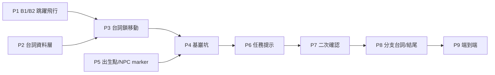

# 流程接線實作計劃

> 相關：[[跳躍與飛行修正計劃]]、交接包 `handoff_info/voxel-demo-mvp_2026-11-16_hand-off/`
> 狀態：**計劃已定案，尚未動任何程式碼**（使用者裁定 2026-11-16 當日只做計劃）
> 專案根：`TSB_Studio_Project/CIS428_Assignment2`

---

## 0. 本次裁定（2026-11-16）

使用者在看過 v3 草稿後，推翻了交接包與我原先的兩個建議，以下是**唯一有效的方向**：

| # | 裁定 | 影響 |
|---|---|---|
| 1 | 中央區域的做法：**把隱形平台改成一層「不能挖掘的基巖」平台** | 不用隱形物理地板，改成真 voxel + 不可破壞規則 → T13（射線打不到）自動消失 |
| 2 | 出生點維持由場景物件 `PlayerStart` 決定，**使用者自己手動移動** | 程式不寫死出生座標，也不需要我改場景檔 |
| 3 | NPC 生成位置**也改成讀場景物件**，使用者自己手動移動 | 新增「讀 marker」邏輯 + fallback |
| 4 | 現有台詞**全部作廢**（只是還沒換），且硬編碼的儲存方式要重構 | 台詞資料層要重新設計，本計劃只建結構，內容由使用者供給 |
| 5 | 台詞顯示期間，玩家**不能自行移動、不能移動視角** | 目前完全沒擋（見 §2 事實 1），是本次新增的必要工作 |
| 6 | 先做 B1/B2（跳躍、飛行下降） | 見 §10 順序 |

**因此本文件取代先前的 v1–v4 排序**；舊的「先挖中央 16×16 完全虛空」已作廢。

---

## 1. 問題陳述

一句話：**遊戲有「世界、玩家、建造、動畫、UI」五套零件，但沒有任何一層負責「什麼時候該出現什麼」，所以從開場到結尾的 6 個節點有 4 個走不到。**

具體表現（皆已對照程式碼確認）：

- 開場黑幕／對話演完後，玩家不知道要做什麼（沒有任務提示）。
- 建造模式下沒有任何「還差幾個」的回饋（`SubmitPrompt` 只有 `Ctrl + Enter to submit` 一行字）。
- `Ctrl+Enter` 一按就進 ending，沒有二次確認。
- 提交後的台詞（`SUBMIT_DIALOGUE`）存在但**從未被 import**。
- 對話期間玩家可以自由走動、轉視角、蓋方塊。

---

## 2. 今天新查證的事實（全部附證據）

| # | 事實 | 證據 |
|---|---|---|
| 1 | **`InputLock` 只是個旗標，沒有任何地方讀它來擋輸入** | 全 `src/` 只有 `acquire` / `releaseAll` / `clear`；`MyGameMode.tickPrePhysics()`（:362-372）從未讀 `inputLock`。`InputLock.ts:66` 註解寫「Gameplay code reads `inputLock.isUnlocked`」，但**沒有任何 gameplay code 這樣做** |
| 2 | 台詞期間的 phase 是 `explore`，`flow.canAct === true` | `onPhaseChanged`（:632）在 `intro → explore` 時呼叫 `startDialogue`，此時 phase 已是 explore |
| 3 | 台詞期間**可以**蓋方塊 | `handleMouseAction`（:934）只檢查 `flow.canAct && this.isBuildMode`，沒有檢查 lock |
| 4 | 移動與視角的唯一出口是 `DefaultPlayerController.tickPrePhysics()` | `MyPlayerController extends ENGINE.DefaultPlayerController`（:52），完全靠 `super` 取得 WASD／jump／look；類別內沒有覆寫 `tickPrePhysics` |
| 5 | 視角可以「吞掉 delta」而不轉向，專案已有現成樣板 | `MyPlayerController.handleMouseMove`（:267-274）：free-look 時 `invoke` 給自由相機後 `return true`，不呼叫 `super` |
| 6 | **不能用 `InputManager.setInputEnabled(false)` 來鎖** | `InputManager.d.ts:289` 存在，但它會連「推進台詞的 Enter」一起吃掉，導致玩家卡在台詞裡 |
| 7 | 場景物件可以用名字找 | `utils/ThreeJsExtensions.d.ts:166` `getNodeByName()`，掛在 `THREE.Object3D` 上 → `world.getRenderScene().getNodeByName('X')` |
| 8 | 目前**沒有** bedrock / 不可破壞的概念 | `blockIds.ts` 只有 0–9；`PLACEABLE_BLOCKS` 9 個；`isPlaceableBlock()` 只用來給 palette，**破壞路徑完全沒檢查 id** |
| 9 | 破壞的最終出口只有一個 | `MyGameMode.breakBlock()`:993 → `build.break(cell)`:179 → `chunk.setVoxelRaw(..., BLOCK_AIR)`:189 |
| 10 | 放置也會覆蓋實心方塊 | `BuildController.place()`:170 前，`shouldWritePlacement('replace', occupied=true)` 仍會寫入 → **基巖必須同時擋「放置」**，否則玩家可以直接把它換掉 |
| 11 | `BreakResult` 已是 union，加新 reason 不破壞既有斷言 | `BuildController.ts:41-47`，`reason: PlaceFailureReason \| 'empty'` |
| 12 | 生成期寫入**不會**污染 `placedBlockCount` | `terrainFill.fillColumn` 透過 callback 直接寫 `volume.voxels`；`placedBlockCount` 只由 `setVoxelRaw`（:119）增減 → 基巖不會讓 `evaluateSubmit` 誤判成 `normal` |
| 13 | `autoAdvance()` 存在但**從未被呼叫** | `updateDialogue`（:715）只呼叫 `update` / `updateDialogueTurn` / `renderDialogueLine`；`DialogueRunner.autoAdvance()` 無呼叫端 → 台詞**一定要玩家按鍵**才前進 |
| 14 | 台詞與演出用「內容比對」耦合，換台詞就會壞 | `updateDialogueTurn`（:742）用 `INTRO_DIALOGUE.findIndex(line => line.speaker === 'loomkeeper')` 決定何時轉身 |
| 15 | `startDialogue` 的型別把內容寫死 | `MyGameMode.ts:1089` `startDialogue(lines: typeof INTRO_DIALOGUE)` |
| 16 | `DEFAULT_WORLD_GEN_CONFIG` 被 3 個地方用 | `buildWorld()`:276 `generateWorld`、`buildBoundsForRadius`、`applyFog` 之後的查表 → 改設定必須三處同改 |
| 17 | 挖空若改 `DEFAULT` 會直接打紅 2 個測試 | `tests/world/WorldGenerator.engine.ts:97`「fills the surface layer in the editable chunk」、`:108`「fills deep layers in the editable chunk」 |
| 18 | `buildBoundsForRadius(0,16)` 被測試釘死 | `tests/build/placement.unit.ts:29` `assertDeepEqual(bounds, {minX:-16, maxX:15, ...})` |
| 19 | 引擎已升級至 **20.0.1**（2026-11-21，TSB Studio 會強制自動升級，無法釘版本） | 19.0.1 的 breaking change 已修：`movementSpeed`→`maxSpeed`、`turnSpeed`→`lookRightSpeed`（`NpcMover.ts`）、`shouldCreateGameLoopDebugUI()` 改為 `!isPublishedGame() \|\| isGenesysDebugEnabled()`（`DebugOverlay.ts`）、`createPhysicsEngine` 改由 `tests/world/engineInternals.ts` 單點相對路徑匯入。**20.0.1 的 breaking change**：`CharacterMovementNode.getGrounded()` 移除，改成 getter `isGrounded`（嚴格版，「本步是否碰到地面」），coyote-time 版本另名 `canGroundJump`；已改 `MyCharacterPawn.ts` 與 `MyGameMode.ts` 兩處 |

### 幾何前提（仍然成立）

- 只有 chunk (0,0) 是 editable；`VoxelChunkNode.ts:72` → chunk (0,0) 覆蓋世界 x ∈ [0,16)、z ∈ [0,16)。
- 地面頂面 `y = surfaceY + 1 = 11`。
- `PlayerStart` 目前在 **`[-10, 12, -10]`**（場景檔 `assets/default.genesys-scene`，rotation `[-π, 0, -π]`，下方掛了一個同位置的 Cube 用來目視），**`snapToGround = true`**。Y 從 20 降到 12 是為了讓引擎的出生探針打得到地面，見 §8 R15。
- → 使用者手動移動 `PlayerStart` 之後，這個耦合就解除了；但**在移動之前**不要先把中央挖深，否則開場即墜落。

---

## 3. 設計演進紀錄

| 版本 | 方案 | 結果 |
|---|---|---|
| v1 | 照交接包：中央 16×16 完全虛空 + `y=−1` 隱形物理地板 | ❌ 出生點在角落 → 開場墜落；洞底非 `VoxelChunkNode` → `isBlockHit()` 濾掉 → 玩家在洞裡放不了方塊（T13）；Loomkeeper 浮空 |
| v2 | 只挖表層一格 | ⚠️ 安全但視覺幾乎看不出來，且不能當「世界破了一個洞」的敘事 |
| v3 | 淺坑 3 格 + 真 voxel 底面 | ✅ 解決 T13 與墜落，但與使用者想要的「空洞感」有距離 |
| **v4（本版）** | **深坑 + 底面一層不可破壞的基巖** | ✅ **採用**。射線打得到（真 voxel）、站得住、看起來是深淵，且玩家不能把底部挖掉 |
| v5（打磨，不在本次範圍） | 坑壁加漸層／霧 | ⏸️ 延後 |

被否決的替代方案一併記在這裡，避免三週後又有人提：

- 「給隱形平台加標記讓 `isBlockHit()` 通過」→ 要改 `BuildController` 的職責邊界（它目前只認 `VoxelChunkNode`），且 undo/redo 的 `chunkForCell` 也拿不到 chunk，會連帶污染三條路徑。
- 「`InputManager.setInputEnabled(false)` 解台詞鎖」→ 會連推進鍵一起吃掉（事實 6）。

---

## 4. 目標行為（可觀察驗收）

> 2026-11-21 更新：P6 的任務提示 HUD 已撤除（「任何設計都有效」），第 3 節點改成「無 banner」；第 6 節點的分支由「夠／不夠」改為「有蓋／沒蓋」。第 5 節點補上確認框的實際文案。
>
> 2026-11-21 最終驗收：六節點**全部通過**（節點 1 靠截圖與 `playerStartAnchor` 測試，節點 2–6 由使用者實機操作）。

| 節點 | 行為 | 驗收方式 |
|---|---|---|
| 1 | 開場黑幕淡入，玩家**站在坑邊的實地上**（不再穿地） | 視覺：能看見坑與基巖底面；站姿高度 ≈ 11.92 |
| 2 | 對話自動開始，**期間玩家不能移動、不能轉視角、不能蓋方塊** | 對話中按住 W 位置不變；動滑鼠視角不動；左鍵只推進台詞 |
| 3 | 對話結束後只有建造 HUD（hotbar／preset tabs／submit prompt），**沒有任務 banner** | 左上角應為空白；B 進建造後三個元件一起出現 |
| 4 | 按 B 進建造，蓋方塊時計數上升；**基巖挖不掉、也蓋不上去** | 對著基巖左鍵無反應；對著基巖右鍵無反應 |
| 5 | Ctrl+Enter → 「Submit this design?」確認框；Esc 取消後 phase／方塊／計數完全不變 | 取消後仍在 building，方塊與計數不變；確認框 dim 覆蓋 HUD |
| 6 | Enter 送出 → 離開建造模式 → 播 `submit` 台詞 → ending 字幕卡；0 塊則不開框、直接播 `submitBlank` | 台詞分支正確；0 塊時按 Ctrl+Enter 不出現確認框 |

**Out of scope（本次明確不做）**
- 不做坑壁材質打磨、不做霧效分層。
- 不改 `buildBoundsForRadius`（被測試釘死，且跨到 solid ring 反而讓玩家能站坑邊蓋）。
- 不做音效、不做存檔、不做多語系。
- 不改台詞**內容**（由使用者提供；本次只建結構與 cue）。

---

## 5. 架構決策

### D1 中央 = 深坑 + 一層基巖（不是隱形地板）

- 新增 `BLOCK_BEDROCK = 10`，**不加入** `PLACEABLE_BLOCKS`，不進 hotbar。
- `WorldGenConfig` 新增 `carveCenterDepth: number`；**`DEFAULT` 必須是 `0`**（事實 17）。
- 遊戲端在 `MyGameMode` 用 `GAMEPLAY_WORLD_GEN_CONFIG = { ...DEFAULT_WORLD_GEN_CONFIG, carveCenterDepth: 8 }` 三處一起換掉（事實 16）。
- 底面規則：`voxelY === surfaceY - carveCenterDepth` → `BLOCK_BEDROCK`；其餘照 full-height。
- 為什麼是「真 voxel」：`BuildController.isBlockHit()` 用 `findOwningChunk()` 過濾，只有 `VoxelChunkNode` 的子節點才通過。真 voxel 的底面天生通過，**不必改 BuildController 的職責**。

### D2 可破壞性判定放在 `BuildController`（單一入口）

`break()` 與 `place()` 都在 `BuildController`，而 `applyUndo/applyRedo` 只回放已記錄的編輯（不會記錄失敗的操作），所以：

- `break()`：`if (!isBreakableBlock(previousBlockId)) return { ok: false, reason: 'protected' };`
- `place()`：`if (previousBlockId === BLOCK_BEDROCK) return { ok: false, reason: 'protected' };` ← **這一條最容易被漏**（事實 10）
- `BreakResult` / `PlaceResult` 的 reason union 各加 `'protected'`（事實 11）。
- `MyGameMode` 只負責把 `protected` 顯示成一句提示，不重複判斷。

### D3 出生點與 NPC 都綁場景物件

- 玩家：**零程式改動**。引擎依 `PlayerStart` 生成 local controller；使用者手動移動該物件即可。
- NPC：`Loomkeeper.ts` 移除硬編碼的 `LOOMKEEPER_SPAWN`，改由 `MyGameMode.spawnLoomkeeper()` 讀 marker：

```ts
const marker = world.getRenderScene().getNodeByName<ENGINE.SceneNode>(LOOMKEEPER_SPAWN_MARKER);
const feet = marker ? marker.getWorldPosition(new THREE.Vector3()) : LOOMKEEPER_FALLBACK_SPAWN;
npc.setWorldPosition(feet.x, feet.y + ENGINE.CHARACTER_HEIGHT / 2, feet.z);
```

- marker 名稱常數化為 `'LoomkeeperSpawn'`；**找不到時 fallback 到現行座標並 `console.warn`**，保持可玩。
- marker 由使用者在 TSB Studio 建立空節點（我不能手改場景檔，見 R3）。

### D4 台詞資料層重構（結構化 + registry + cue）

現況：`DialogueLine.ts` 一個檔同時放型別、時間數學、三份台詞陣列，且演出靠 `speaker === 'loomkeeper'` 猜。

改成三層：

```
src/dialogue/types.ts        型別（DialogueLine、DialogueCue、DialogueScriptId）
src/dialogue/text/timing.ts  純函式（visibleText / isLineComplete / lineDuration）
src/dialogue/scripts/intro.ts      內容（使用者之後替換）
src/dialogue/scripts/submit.ts     內容（good / sparse / blank）
src/dialogue/scripts/index.ts       registry: DIALOGUE_SCRIPTS[id]
```

關鍵改動：

1. `DialogueLine` 新增 `cue?: DialogueCue`，`DialogueCue = 'turnPlayerToLoomkeeper'`。`updateDialogueTurn` 改成「找第一個帶 `turnPlayerToLoomkeeper` cue 的索引」→ **換台詞不需要改程式**（事實 14）。若沒有任何行帶 cue，就不轉身。
2. `startDialogue(scriptId: DialogueScriptId, onFinished?: () => void)` 取代 `startDialogue(lines)`（事實 15）。
3. ~~`DialogueLine.ts` 保留成 re-export（降低 churn）~~ → **實際做法：直接刪除**，理由見 §6 P2 落地第 1 點。
4. **本次不改台詞內容**，只把現有 14 句搬進 `intro.ts` 當佔位，並標 `// TODO(text): 待替換`。

### D5 台詞期間鎖移動與視角

兩層，缺一不可：

| 層 | 位置 | 做法 |
|---|---|---|
| 移動 / 視角 | `MyPlayerController` | 覆寫 `tickPrePhysics()`：`if (inputLock.isLocked) { this.clearHeldKeys(); return; }`（不呼叫 `super`） |
| 視角增量 | `MyPlayerController.handleMouseMove()` | `if (inputLock.isLocked) return true;`（吞掉 delta，避免解鎖瞬間鏡頭暴衝） |
| 遊戲動作 | `MyGameMode.handleAction` / `handleMouseAction` | 在既有 `flow.canAct` 判斷前，先擋「非 `advanceDialogue`、非 debug」的動作 |

要點：

- **不呼叫 `super.tickPrePhysics()` 就等於凍結**，因為 WASD/jump/look 全在裡面（事實 4）。
- `handleMouseMove` 一定要吞，否則鎖期間 delta 會累積在 `DefaultPlayerController` 的私有累加器裡，解鎖後一次吐出（這是設計上最容易漏的坑）。
- `handleKeyDown` 仍要繼續運作（台詞推進鍵、Esc 都在裡面）。
- **不要** `releasePointerLock`，否則解鎖後要重新點擊才能轉視角。

### D6 任務提示 HUD（已撤除）

原本新增 `src/ui/ObjectiveBanner.ts`，沿用 `DialogueBox` 的手法：`Message` + `setPosition({ position: 'absolute', ... })`（`customStyles` allowlist 會擋 `position/top/left/transform`），內容 `Place 5 blocks (3 / 5)`。

**2026-11-21 撤除**：使用者決定「任何設計都有效，沒有最低方塊數」，banner 承諾的目標因此不存在，整個檔案連同 `REQUIRED_BLOCKS` / `objectiveProgressText()` / `objectiveMet()` 一起刪除。理由見 P6 段落。

### D7 二次確認

新增 `src/ui/ConfirmDialog.ts`（純 DOM，不用引擎元件；理由見 P7 段落）。`MyGameMode` 新增 `isConfirming`：

- `submitDesign()` 進入確認時 `inputLock.acquire('menu')`（`'menu'` reason 已存在）。
- Enter = 是、Esc = 否；兩個鍵都必須**繞過** D5 的鎖，因此確認框的處理要放在 lock 判斷之前。
- 取消時 `inputLock.release('menu')`，phase 不變、方塊不動。

### D8 提交後的台詞分支與結尾卡

`SUBMIT_LINES` / `SUBMIT_BLANK_LINES` 兩個分支（原本設想的 `GOOD` / `SPARSE` / `BLANK` 三分支因「取消最低方塊數」縮成兩支）。`GameFlow` 的 `'normal'` 分支流程不變，只在 `startEnding()` 之前插一段台詞，並用 `onFinished` 接續（D4 第 2 點）。

`EndCard.ts` 只改三個字串常數，不動序列（`endingSequence()` 已完整）。

---

## 6. 實作步驟

### P1 — B1 跳躍 / B2 飛行下降（2h）— ✅ 已完成（2026-11-17）

- 檔案：`src/input/keyBindings.ts`、`src/character/MyPlayerController.ts`、`src/game/MyGameMode.ts`、`tests/input/keyBindings.unit.ts`、`tests/character/playerStack.engine.ts`
- 內容：照 [[跳躍與飛行修正計劃]] 的工單（新增 `MODIFIER_CODES` 短路、`isFlying` 欄位、單擊分支改 `return this.isFlying`）。
- 實際落地：
  - `keyBindings.ts:136` `MODIFIER_CODES`；`:167` 短路 `return !e.altKey`（保留 Alt 給上帝視角的環繞和弦）
  - `MyPlayerController.ts:109` `public isFlying`；`:269` `return this.isFlying`
  - `MyGameMode.ts:626` 私有 `syncFlyingToController()`，於 `:609`（落地自動取消）與 `:931`（玩家切換）兩處呼叫
- 驗收：**678 / 678 passed**（+10 新案例：7 個 `matchesBinding`、3 個控制器／同步）。
- **為什麼排第一**：坑做完之後，「掉進坑只能飛出來」完全依賴這一項。
- ⚠️ 手動驗證（跳／雙擊起飛／Ctrl 下降／Alt+Tab）尚未執行 —— 需在 TSB Studio 按 Play。

### P2 — 台詞資料層重構（3h，行為不變）— ✅ 已完成（2026-11-20）

**⚠️ 範圍變更（使用者 2026-11-20 指示）**：原有 14 句台詞（N2–N5）**全部作廢**，是舊版草稿，不是本作要的台詞。因此 P2 **不搬移任何既有台詞內容**，改為只建結構並留下明確標記的佔位。

落地結構：

```
src/dialogue/types.ts          DialogueLine / DialogueCue / DialogueScriptId / SPEAKER_NAMES
src/dialogue/constants.ts      TYPEWRITER_CHARS_PER_SECOND / DEFAULT_LINE_PAUSE
src/dialogue/text/timing.ts    visibleCharacters / visibleText / isLineComplete / lineDuration / lineTotalDuration / totalCharacters
src/dialogue/scripts/intro.ts       INTRO_LINES（7 句佔位）
src/dialogue/scripts/submit.ts      SUBMIT_LINES / SUBMIT_BLANK_LINES
src/dialogue/scripts/index.ts       DIALOGUE_SCRIPTS / getDialogueScript / dialogueLines / findCueIndex
```

關鍵落地：

1. **`DialogueLine.ts` 直接刪除**，不留 re-export 相容層。原本計劃保留以降低 churn，但實測全專案只剩一個測試檔引用它，改成直接 import 具體模組後 churn 就是零，留著只是死程式碼。`src/auto-imports.ts` 同步改列五個新模組。
2. `DialogueLine` 新增 `cue?: DialogueCue`（目前只有 `'turnPlayerToLoomkeeper'`）。`updateDialogueTurn()` 從「掃第一個 `speaker === 'loomkeeper'`」改成 `findCueIndex(activeDialogueId, 'turnPlayerToLoomkeeper')` → **換台詞不需要改程式**。
3. `startDialogue(scriptId, onFinished?)` 取代 `startDialogue(lines)`；新增 `activeDialogueId`（cue 查表需要知道跑哪個 script）。
4. 新增 `finishDialogue()`：原本「自動推進」與「玩家跳過」兩條路徑各自複製一份 teardown（`dialogue = null` / `releaseAll('dialogue')` / `hide()`），現在收斂成一處，並在此執行 `onFinished`。callback 會先清空再呼叫，避免「延續動作又開新對話」時被殘留的舊 callback 重入。
5. **台詞內容全部是佔位**，逐句標 `（開場：… 待補）`，檔頭寫明「不可視為最終文字」。`cue` 掛在「玩家第一次看見說話者」那一句，位置可調但**只能有一個**。

測試調整（`tests/dialogue/dialogue.unit.ts`）：

- **刪除**所有綁死舊台詞文字的斷言（`includes('哪裡')`、`includes('B')`、`includes('Ctrl')`、N2/N3 的 speaker 順序），因為那些台詞已作廢，留著會逼未來的內容去迎合已廢棄的草稿。
- **新增**結構性斷言：每個 script 的 `id` 與 key 相符、speaker 都在 `SPEAKER_NAMES`、文字非空、`intro` 恰好一句帶 turn cue、`findCueIndex` 依名字定位、無 cue 的 script 回 -1、未知 id 會 throw。
- 播放測試改用 `INTRO_LINES`（實體陣列），不再經相容別名。

驗收：**739 / 739 passed**（總數不變：刪 11 個內容斷言、增 10 個結構斷言 + 1 個 throw 案例）、`tsc --noEmit` 0 錯誤、`pnpm turbo:build` 通過。

**未做**：台詞文字本身。等使用者提供新台詞後，只需改 `scripts/intro.ts` 與 `scripts/submit.ts`，並確認 turn cue 掛在正確的那一句。

### P3 — 台詞期間鎖移動／視角（2h）— ✅ 已完成（2026-11-21）

落地：

| 檔案 | 改動 |
|---|---|
| `src/character/MyPlayerController.ts` | 新增 `tickPrePhysics` 覆寫：`inputLock.isLocked` 時**不呼叫 `super`**，並清掉 `isPrimaryVerticalHeld` / `isSecondaryVerticalHeld`。`handleMouseMove` 在鎖期間回 `true` 吞掉 delta（含 free-look 分支之前），因此 `onMouseLook` 不觸發、私有 look 累加器也不會累積 |
| `src/game/MyGameMode.ts` | `handleAction` 在四個開發工具（F3+B / F3+C / F4 / F5）與 `advanceDialogue` **之後**加鎖閘；`handleMouseAction` 在 `advanceDialogue` 之後、建造判斷之前加鎖閘；`updateVerticalInput` 讀 held 旗標時一併看 `inputLock.isUnlocked` |

三個關鍵決定：

1. **跳過整個 `tickPrePhysics` 而不是只歸零輸入** —— 基底類別的 `forward` / `mouseLookUp` 全是 `private`，沒有「只走位不轉視角」的介面。整段跳過同時保證 look 累加器維持 0，解鎖後視角不會依對話期間滑鼠移動的距離暴衝（§8 R5）。
2. **鎖閘必須放在開發工具之後** —— F3+B、F3+C、F4、F5 要在鎖住時仍可用，否則卡住的對話無法診斷。
3. **`updateVerticalInput` 也要看鎖** —— `MyGameMode` 的 tick 早於控制器的 `tickPrePhysics`，若只看 held 旗標，對話期間按下的 Space 會在控制器清旗標之前先被讀到一次，造成跳躍或上升。

`GameFlow` 原本就已經在 `intro` / `ending` 電影時 acquire（`startIntro()` / `startEnding()`），所以這次的鎖閘同時覆蓋電影期間的移動，不只是台詞。

驗收：`tests/character/inputLock.engine.ts` 新增 6 案例（未鎖時走位、鎖時不走位、鎖時清 held 旗標、解鎖後恢復、鎖時吞視角 delta、解鎖後恢復視角）→ **805 / 805 passed**（48 檔 / 188 suite）、`tsc --noEmit` 0 錯誤、`pnpm turbo:build` 通過。

⚠️ 手動四項（W 不動、滑鼠不轉、左鍵只推進、Esc 不解鎖）需在 TSB Studio 按 Play 確認。

### P4 — 中央基巖坑（3h）— ✅ 已完成（2026-11-21）

落地：

| 檔案 | 改動 |
|---|---|
| `src/voxel/blockIds.ts` | `BLOCK_BEDROCK = 10`、`isProtectedBlock()`、`isBreakableBlock()`；**不加入** `PLACEABLE_BLOCKS`，`BLOCK_NAMES` 加 `Bedrock` |
| `src/voxel/materialMap.ts` | `[BLOCK_BEDROCK]: stone ×6`（顯式列出，意圖可見；石頭 key 本來就在 palette 裡，所以不需要新 slot） |
| `src/world/WorldGenConfig.ts` | `carveCenterDepth`（**DEFAULT 0**）、`carvedFloorY()`、`hasCarvedCenter()`、驗證（非負整數、不得挖穿 `minY`） |
| `src/world/terrainFill.ts` | `blockIdForCarvedColumn()`：floor 以上全 air、floor 層 `BLOCK_BEDROCK`、floor 以下照 sub-surface；`carveCenterDepth <= 0` 時退回 full-height |
| `src/world/WorldGenerator.ts` | `fillChunkData(..., carved = false)`；`generateWorld()` 只對 editable chunk 傳 `carved`，外圈維持平地 |
| `src/build/BuildController.ts` | `break()` / `place()` 的 `protected` 分支；`BreakResult` / `PlaceResult` 的 reason union 各加 `'protected'` |
| `src/ui/ToastHint.ts`（新增） | 自動消失的一行提示（`TOAST_VISIBLE_SECONDS = 1.8`、`PROTECTED_BLOCK_HINT`） |
| `src/ui/GameUiBundle.ts` | bundle 加 `toast`，`setBuildUiVisible(false)` 一併 `toast.hide()`，`destroyGameUi` 一併 destroy |
| `src/game/MyGameMode.ts` | `GAMEPLAY_WORLD_GEN_CONFIG = { ...DEFAULT, carveCenterDepth: 8 }` 取代全部 7 處參考（不只是 3 處：另有 2 處 debug 快照與 `chunkForCell`）；`reportBlockedEdit()` 只對 `protected` 顯示提示 |
| `src/debug/InputLog.ts` | `InputEventKind` 加 `'blocked'`（被拒絕的編輯不是 `edit`，但需要時間戳） |

三個關鍵決定：

1. **`place()` 也必須擋** —— `replace` 模式本來就會覆蓋實心方塊，只擋 `break()` 的話玩家可以直接把基巖埋掉，坑底就消失了（§8 R2）。判斷放在 `occupied` 之前，所以 `skip` / `replace` 兩種模式都一致。
2. **判定放在 `BuildController`，不在 `MyGameMode`** —— `applyUndo/applyRedo` 只回放已記錄的編輯，失敗的操作根本不會入堆疊，所以 undo 不可能復活被擋下的破壞（§5 D2）。
3. **提示用新的 `ToastHint` 而不是吃掉既有 widget** —— `SubmitPrompt` 常駐在右下、`DialogueBox` 屬於對話狀態，兩者都不能借用。`ToastHint` 自己數 `tick(deltaTime)`，在 `tickPrePhysics` 內推進。

**取代了「不改場景檔」的出生點前提**：PlayerStart 原本在 [0, 20.1, 0]（坑的角落），按 Play 會直接掉到 y = 3 的基巖上。✅ 使用者已把它移到 [-10, 12, -10]，此前提已解除。

驗收：`tests/world/terrainFill.unit.ts` +4（坑底基巖、坑內全 air、floor 以下仍是岩石、depth 0 與平地一致）、`tests/world/worldGen.unit.ts` +6（預設無坑、合法坑、負數／小數／挖穿 minY 各自 throw）、`tests/world/WorldGenerator.engine.ts` +3（只挖 editable chunk、坑底基巖、DEFAULT 仍平坦）、`tests/build/BuildController.engine.ts` +3（挖基巖失敗、覆蓋基巖失敗、坑內可放置）、`tests/integration/uiWiring.unit.ts` +3（toast 版面、allowlist、提示文字）→ **823 / 823 passed**、`tsc --noEmit` 0 錯誤、`pnpm turbo:build` 通過。

⚠️ 手動驗收（坑底可見基巖、左鍵／右鍵基巖無反應且出現提示、坑內對坑壁可放置）需在 TSB Studio 按 Play。`PlayerStart` 已移出坑外，可直接驗。
### P5 — 出生點與 NPC marker（1h）— ✅ 已完成（2026-11-21）

落地：

| 檔案 | 改動 |
|---|---|
| `src/character/npcSpawn.ts`（新增） | `LOOMKEEPER_SPAWN_MARKER = 'LoomkeeperSpawn'`、`LOOMKEEPER_FALLBACK_FEET`、`NPC_HEIGHT`、`pawnCentreFromFeet()`、`resolveNpcSpawn()`、`isFinitePoint()`；**零引擎 import**，可純單元測試 |
| `src/character/Loomkeeper.ts` | 刪除硬編碼 `LOOMKEEPER_SPAWN` 與 `NPC_HEIGHT`，改 import `npcSpawn.ts`；檔頭註明「擺位不是這個類別的責任」 |
| `src/game/MyGameMode.ts` | `spawnLoomkeeper()` 改讀 marker（新增私有 `readSpawnMarker()`）；缺 marker 時 `console.warn` 並用 fallback |
| `src/auto-imports.ts` | 加 `./character/npcSpawn.js` |

兩個關鍵決定：

1. **marker 代表「腳」，不是「膠囊中心」** —— 空節點沒有體積，它的 position 就是那個點，所以放在地上最直觀。轉換（`+ CHARACTER_HEIGHT / 2`）集中在新模組，`Loomkeeper.ts` 不再知道這件事。這也順帶把「marker 是腳 / pawn 是中心」這個易錯點從散落變成一個函式。
2. **非有限座標視為「沒有 marker」** —— 壞掉的場景檔可能給出 `NaN`，而 `NaN` 的 position 會讓模型**無聲消失**（沒有任何錯誤），比缺少 marker 更難查。`resolveNpcSpawn()` 會退回 fallback。

**已有 marker（2026-11-21）**：用 Studio MCP 在 `assets/default.genesys-scene` 建立 `ENGINE.SceneNode`，名為 `LoomkeeperSpawn`，position **(-10, 11, -14)**，rotation 0、scale 1。

| 決定 | 理由 |
|---|---|
| **y = 11** | 外圈 ring 的 voxel 只填 `surfaceY = 10` 那一層，頂面在 11；節點代表「腳」，所以 y 直接取 11，不再加半個身高 |
| **x = -10, z = -14** | PlayerStart 在 (-10, 12, -10)，LoomkeeperSpawn 放在它 **4 格之後（-Z）** 且仍在同一塊 ring chunk (-1,-1) 的實地上。N3 的設計是「先聽聲再轉身」，所以 NPC 必須在玩家出生視線之外；Y 不影響水平關係 |
| **不能放 (0, 11, 4)** | fallback 那個座標現在**懸在坑口上方**：可編輯 chunk (0,0) 整塊已被 `carveCenterDepth = 8` 挖空（y=3 以上全 air、y=2 是基巖）。fallback 只是保底值，不是理想擺位 |

> ⚠️ 座標是我依「玩家面朝 +Z」推算的（`PlayerStart` rotation `[-π, 0, -π]` 的淨旋轉使 forward = +Z）。若實機發現 NPC 反而在正前方，直接把節點拖到 z > -6 即可，**不必改程式** —— 這正是 marker 存在的目的。

驗收：`tests/character/npcSpawn.unit.ts` 新增 6 案例（腳→中心換算、水平不動、有 marker 用 marker、無 marker 用 fallback、NaN marker 退回 fallback、坑底 marker 合法）→ **831 / 831 passed**（49 檔 / 192 suite）、`tsc --noEmit` 0 錯誤、`pnpm turbo:build` 通過。場景檔已存檔，節點在 `world.getNodeByName('LoomkeeperSpawn')` 可取得。

⚠️ 手動驗收需先建立 marker。

### P6 — 任務提示 HUD — ❌ 已撤除（2026-11-21 完成，同日撤除）

**原始目標**：建造模式下常駐顯示「要放幾個方塊、現在放了幾個」。

**撤除原因**：P7 出 SVG 草圖時詢問玩家「未達 5 塊怎麼辦」，使用者回答**任何設計都有效**（「即使只是在牆上貼一根香蕉」），最低方塊數原本只是為了彩蛋、而彩蛋已因時間不足取消。既然沒有門檻，`Place 5 blocks (3 / 5)` 就是在承諾一件不存在的事；使用者選擇**整個 banner 移除**。

**撤除內容**

| 檔案 | 改動 |
|---|---|
| `src/ui/ObjectiveBanner.ts` | **刪除** |
| `src/build/submitCheck.ts` | 刪除 `REQUIRED_BLOCKS`、`objectiveProgressText()`、`objectiveMet()`；保留 `evaluateSubmit()` / `isBlankSubmission()` |
| `src/ui/GameUiBundle.ts` | bundle 移除 `objective`、`BUILD_UI_POSITIONS.objective`、show/hide 與 destroy 分支 |
| `src/game/MyGameMode.ts` | `updateHud()` 移除 `ui.objective.update()` |
| `src/auto-imports.ts` | `./ui/ObjectiveBanner.js` → `./ui/ConfirmDialog.js` |
| 測試 | `submitCheck.unit.ts` 的 7 個 objective 案例、`uiWiring.unit.ts` 的 5 個 banner 案例一併刪除 |

**保留的判斷**：`evaluateSubmit()` 仍區分 `blank` / `normal`。這不是設計門檻，而是「完全沒動工就不要送去給 Keeper 讀」的守門；0 塊時 `Ctrl + Enter` 直接進 `submitBlank` 台詞（維持原本行為，且此時 submit prompt 本來就是隱藏的）。

### P7 — 二次確認（3h）— ✅ 已完成（2026-11-21）

**目標**：`Ctrl + Enter` 不再直接結束遊戲。在那之前先問一次，Esc 可以把人送回建造、世界完全不動。

**設計演進紀錄**

| 版本 | 方案 | 結果 |
|---|---|---|
| v1 | 三個區塊的 SVG：全螢幕情境＋兩種內容狀態＋**變體 B 底部橫幅** | ❌ 底部橫幅會壓到 hotbar，且與 submit prompt 搶同一條底邊 |
| v2 | 只有置中面板；含「未達 5 塊」的獨立狀態 | ❌ 最低方塊數取消，該狀態不存在 |
| v3 | 置中面板＋dim 55%＋無副行＋Enter 永遠可用 | ✅ 採用 |

**落地**

| 檔案 | 改動 |
|---|---|
| `src/ui/ConfirmDialog.ts`（**新增**） | 純 DOM 面板：dim 層 `z-index 1004`、面板 `1005`、480px 寬、`translate(-50%,-50%)` 置中；匯出 `CONFIRM_DIALOG_TITLE` / `_FOOTER` / `CONFIRM_ACCEPT_KEY` / `CONFIRM_CANCEL_KEY` 及各段 styles。無 `document` 時建立「空」實例，只追蹤 `isVisible` |
| `src/ui/GameUiBundle.ts` | bundle 加 `confirm`；**不納入 `setBuildUiVisible()`**，只納入 `destroyGameUi()` |
| `src/game/MyGameMode.ts` | `isConfirming` getter、`openSubmitConfirm()` / `cancelSubmit()` / `confirmSubmit()` / `submitConfirmedDesign()`；`handleAction()` 最前面加確認框分流 |
| `src/auto-imports.ts` | 加 `./ui/ConfirmDialog.js` |
| 測試 | `uiWiring.unit.ts` 的 banner 案例改成 7 個確認框案例；bundle fake 移除 `objective`、加 `confirm`（並斷言它**不被** show/hide） |

**關鍵決定**

- **純 DOM，不用 `Message` + `Keystroke`**：草圖要求面板內**垂直**堆疊（標題／分隔線／橫排／footer），而 `Message` 是 flex **row**，`flex-direction` 與 `position` 都不在 `customStyles` allowlist 裡。與其和模板對抗，不如沿用 `BlackOverlay` 已經證明可行的做法——一個絕對定位的 div。配色與尺寸仍照 Game UI Kit（chip `#2d3250`、15% 白邊、圓角 6px、11px mono 大寫）。
- **`z-index` 兩個數字**：`#ui-container` 是 `1000`，所以 dim 用 `1004` 蓋掉整個 HUD、面板用 `1005` 不被自己的 dim 壓暗，同時都低於 `BlackOverlay` 的 `9999`（結尾淡出仍要能蓋過一切）。
- **確認框分流放在 `handleAction()` 最前面**：`Enter` 同時綁在 `advanceDialogue` 與 `submitDesign` 上，若放在既有的 `advanceDialogue` 早退之後，Enter 會先被送給空的 `DialogueRunner`；再往後則會被 `inputLock`（本框自己持有的 `'menu'` 鎖）吞掉。這一條即 §8 R6。
- **`setBuildUiVisible()` 不碰確認框**：確認框是由明確動作開啟、自己關閉的；若綁進建造模式的可見性，離開建造模式會關掉玩家正在讀的面板。
- **0 塊不開確認框**：沒有東西要確認，直接進 `submitBlank` 台詞。同時 submit prompt 在 0 塊時本來就隱藏，兩者行為一致。
- **`pointer-events: none`**：按鈕是純鍵盤的；真正阻止玩家在框後方蓋方塊的是 `inputLock`，不是 DOM。

**驗收**

- [x] `Ctrl + Enter` 開框；`Enter` / `Ctrl + Enter` 接受、`Esc` 取消、其餘按鍵被吞掉
- [x] 取消後 `phase` 不變（不呼叫 `flow.dispatch`）、方塊與計數不動、`inputLock` 的 `'menu'` 已釋放
- [x] 接受後才 `overlay.show()` → `ending`
- [x] 面板 480px、置中、dim 在面板之下、兩者都在結尾淡出之下
- [x] `ConfirmDialog.create()` 在沒有 `document` 的測試環境不炸，且 `isVisible` 正確跟隨 `show()` / `hide()`
- [x] `tsc --noEmit` 0 錯、`verify` **838 passed / 0 failed**、`turbo:build` 通過
- [ ] **實機**：Ctrl+Enter 出現確認框、Esc 回到建造、Enter 進結尾（待 P9 一起走）
- 草圖：[P7-確認框.svg](./prototypes/P7-確認框.svg)

### P8 — 分支台詞串接 + 結尾卡佔位文案（2h）— ✅ 已完成（2026-11-21）

**目標**：讓「提交成功」真的走完一段台詞才進結尾；「提交空白」真的把玩家退回建造。在此之前 `submit` 那段台詞是**死碼**——`dispatch('submit')` 成功後直接 `overlay.show()`，`SUBMIT_LINES` 從未被播放，玩家付出一整個流程卻一句回饋都沒看到。

**台詞存放位置的結論（使用者提問）**

台詞放在 **TypeScript 模組**，不是 JSON，也沒有 loader：

| 檔案 | 內容 |
|---|---|
| `src/dialogue/types.ts` | `SpeakerId` / `DialogueLine`（`speaker` / `text` / `pauseAfter?` / `cue?`）/ `DialogueScriptId` / `SPEAKER_NAMES` |
| `src/dialogue/scripts/intro.ts` | `INTRO_LINES`（7 句） |
| `src/dialogue/scripts/submit.ts` | `SUBMIT_LINES` / `SUBMIT_BLANK_LINES`（各 2 句） |
| `src/dialogue/scripts/index.ts` | `DIALOGUE_SCRIPTS` 註冊表 + `getDialogueScript()` / `dialogueLines()` / `findCueIndex()` |
| `src/cinematic/EndCard.ts` | `END_CARD_TITLE` / `END_CARD_SUBTITLE` / `END_CARD_HINT`（純字串常數） |

維持 TS 而非 JSON 的理由：`DialogueLine` 的型別（`SpeakerId` 聯合、`cue` 只能是已實作的舞台指示）在編譯期就擋掉錯字；換成 JSON 要另外寫 schema 驗證與載入步驟，而改文案的人只需要改 `text` 欄位——`scripts/*.ts` 本來就只是資料陣列。若之後要整批匯出／匯入，再抽 JSON 也不影響呼叫端（`getDialogueScript()` 是唯一入口）。

**落地**

| 檔案 | 改動 |
|---|---|
| `src/game/MyGameMode.ts` | `submitConfirmedDesign()` 重新排序：空白 → 留在建造模式播 `submitBlank`；非空白 → **先 `setBuildMode(false)`**，再 `startDialogue('submit', () => beginEnding())`。新增 `beginEnding()` 負責 `dispatch('submit')` + `overlay.show()`。`submitDesign()` 的空白分支改走同一條路徑。`startDialogue()` 順手 `placementPreview.hide()` |
| `src/dialogue/scripts/submit.ts` | 兩個分支各 2 句佔位（原本各 1 句）；檔頭改成「NOT FINAL TEXT」並註明台詞存放位置 |
| `src/dialogue/scripts/intro.ts` | 檔頭補上「台詞是 TypeScript，不是 JSON」 |
| `src/cinematic/EndCard.ts` | `END_CARD_TITLE` / `END_CARD_SUBTITLE` 改為 `（結尾卡標題：待補）` / `（結尾卡副標：待補）`；`END_CARD_HINT` **保持真實文案**（它描述 Esc 真的會做的事） |
| 測試 | `dialogue.unit.ts` 的把關改成「除了 intro，其他腳本都不得帶 `cue`」；`gameFlow.engine.ts` 新增「離開建造模式後仍可提交」 |

**關鍵決定**

- **台詞在結尾之前，不是在結尾之中**：`endingSequence()` 的開頭是 `turnPlayer` / `turnLoomkeeper`（把鏡頭轉走），若先 dispatch 就會在 Keeper 講話時把畫面轉開。所以順序是「台詞 → 講完 → 進結尾」。
- **離開建造模式要在台詞之前**：`setBuildMode(false)` 會把 hotbar / tabs / prompt 收起來，對話才是在「世界」上而不是在「HUD」上。這也順帶讓 `flow` 處於 `explore`，於是新增的測試釘住「`submit` 不要求建造模式」——`dispatch()` 的 `submit` 分支本來就只看 `placedBlockCount`，不看 `phase`。
- **空白分支不離開建造模式**：玩家正被要求再試一次，把他丟回 `explore`（還要再按一次 B）只是多一個步驟。
- **`placementPreview.hide()` 放在 `startDialogue()`**：`updateHud()` 在對話期間提早 return，`updatePlacementPreview()` 因此不會跑，準心上的半透明方塊會整段對話掛在那裡。放在 `startDialogue()` 才涵蓋所有對話（intro 也一樣受益）。
- **`END_CARD_HINT` 不列為待補**：它是操作說明不是台詞，改掉會變成錯的說明。
- **`SPEAKER_NAMES` 不動**：`織界者` / `???` / `你` 是角色顯示名，屬世界觀設定而非這輪的台詞寫作；要改時改 `types.ts` 一處即可。目前它與英文 HUD 混用，是已知的未統一項。

**驗收**

- [x] 非空白提交 → 離開建造模式 → 播 `SUBMIT_LINES` → 播完才進結尾
- [x] 空白提交 → 不開確認框 → 留在建造模式播 `SUBMIT_BLANK_LINES`
- [x] `dispatch('submit')` 在 `explore` 階段仍被接受
- [x] 除 `intro` 外沒有任何腳本帶 `turnPlayerToLoomkeeper`
- [x] 台詞與結尾卡文案全部標記為待補，且沒有任何斷言綁在實際字句上
- [x] `tsc --noEmit` 0 錯、`verify` **839 passed / 0 failed**、`turbo:build` 通過
- [ ] **實機**：兩條分支各走一次（待 P9）
- [ ] **文案**：使用者最後統一撰寫（`scripts/*.ts` 的 `text` + `EndCard.ts` 的兩個常數）

### P9 — 端到端（2h，需在 TSB Studio 按 Play 重建 `.dist/game.js`）— ✅ 已完成（2026-11-21）

**結果：§4 六節點全部通過**（節點 1 由截圖 + `PlayerStart` 測試確認；節點 2–6 由使用者實機操作確認）。

驗收過程中的兩個插曲，都不是 bug：

- **截圖拍不到 UI**：`captureScreenshot` 只拍 WebGL canvas，`#ui-container` 是 DOM 層，所以對話框／hotbar／tabs 在截圖裡完全看不到。判斷 UI 是否存在**只能靠實機觀察**，不能靠截圖。
- **中央一大片黑**：被挖空的 chunk 面在現行光照下呈黑，屬預期。白色小十字就是 `CrosshairReticle`（使用者描述「白且太小」，暫不修）。

- 依 §4 六節點逐項走一次
- **`.dist/game.js` 只由 TSB Studio 產生**，`pnpm build` 不會更新
- **前置作業已完成（2026-11-21）**：`ISSUE-006`（開場下墜）已修 —— `PlayerStart.snapToGround = true`，marker Y 由 20 降到 12，並加上解析場景檔的回歸測試。P9 開場應該直接站在地面上，不再穿地 3–4 格
- **P9 要特別確認的**：開場站姿高度是否 `≈ 11.92`（地面 11 + 膠囊半高 0.9 + clearance 0.02）；若明顯更高或更低，代表探針命中的不是預期的 ring chunk 地面

---

## 7. 驗證

自動：

```powershell
cd TSB_Studio_Project\CIS428_Assignment2
pnpm exec tsc --noEmit; pnpm run verify
```

- 基線：**P1 前 668**、**P1 後 678**、**P3 後 805**、**P4 後 823**、**P5 後 831**、**P6 後 843**、**P7 後 838**、**P8 後 839**、**ISSUE-006 後 843 passed / 0 failed**（P6 撤除 −12；P7 +7；P8 +1；ISSUE-006 +4）
- 門檻：測試總數 ≥ 668 + 本次新增，且 0 failed（目前 843）
- 測試 harness 是自製的（`scripts/verify/harness.js`），**沒有 `expect`**，用 `assertEqual` / `assertTrue` / `assertDeepEqual` / `assertThrows`
- 副檔名即層級：`.unit.ts`（無 DOM，UI 元件要 headless 守衛）、`.engine.ts`（有世界與 Rapier），一檔只能一種

### `eslint` 在目前環境無法執行（環境問題，非程式問題）

`eslint .` 會以 `ERR_MODULE_NOT_FOUND: @typescript-eslint/parser` 失敗，原因是引擎的 `eslint-config.js` 位於 pnpm 全域 store 的 link 目錄，Node 從該路徑解析時找不到專案的 parser。與本次改動無關。若需 lint，須在 `pnpm` 可用的 shell（TSB Studio 內建終端）執行。已知其中 2 個 `game-ui/no-page-level-ui` 錯誤在升級前就存在（見 §8 R13）。

手動（P9）：六節點逐項 + 邊界八項（鎖期間按 B／按 Esc／Alt+Tab／坑內放置／基巖破壞／取消確認／空提交／最後一句按鍵）。

---

## 8. 風險

| # | 風險 | 說明 | 緩解 |
|---|---|---|---|
| R1 | **坑做了、出生點沒搬 → 開場墜落** | PlayerStart 原本在 [0, 20.1, 0]，正好是坑的角落 | ✅ 已解：使用者已把 PlayerStart 移到坑外的 ring 上，按 Play 不會落在基巖上 |
| R2 | `buildBounds` 跨 4 chunk 且被測試釘死 | `placement.unit.ts:29` | 不改；跨到 solid ring 反而讓玩家能站坑邊蓋 |
| R3 | 場景檔只能在 TSB Studio 內改 | 手改會被覆寫 | P5 的 marker 由使用者建立；程式對缺 marker 有 fallback |
| R4 | Loomkeeper 換位後「先聽聲再轉身」可能失效 | `updateDialogueTurn` 依 cue 轉身，但玩家是否「剛好看不到」取決於 marker 位置 | P9 實機確認；必要時由使用者調 marker 到玩家側後方 |
| R5 | 解鎖瞬間鏡頭暴衝 | `DefaultPlayerController` 的私有 look 累加器 | D5 要求 `handleMouseMove` 在鎖期間吞 delta |
| R6 | 確認框按鍵被 D5 的鎖擋掉 | 鎖在 handleAction 前段 | 確認框處理必須在 lock 判斷**之前** |
| R7 | 基巖被「放置」覆蓋 | `shouldWritePlacement('replace', occupied)` 仍會寫 | ✅ 已解：`place()` 在 `occupied` 判斷之前先看 `isBreakableBlock()` |
| R8 | 換台詞內容時演出壞掉 | 舊機制用 `speaker==='loomkeeper'` 猜 | D4 改成顯式 cue |
| R9 | 改 `DEFAULT_WORLD_GEN_CONFIG` 打紅測試 | 事實 17 | 挖空走 `GAMEPLAY_WORLD_GEN_CONFIG`，DEFAULT 保持 0 |
| R10 | `buildWorld()` 三處設定漏改一處 | 事實 16 | ✅ 已解：`MyGameMode` 內實際有 7 處參考，全部改指 `GAMEPLAY_WORLD_GEN_CONFIG`；`grep` 只剩 import 與定義 |
| R11 | `MyGameMode.ts` 縮排錯位約 40 處 | 編輯時看縮排會誤判層級 | 改動一律用錨點字串定位，不靠縮排 |
| R12 | 交接包部分事實已過時 | `INTRO_DIALOGUE` 已有 14 句、`SUBMIT_DIALOGUE` 已存在、`REQUIRED_BLOCKS` 不存在 | 以本文件 §2 為準 |
| R6 | 確認框按鍵被 D5 的鎖擋掉 | 鎖在 handleAction 前段 | ✅ 已解：確認框分流放在 `handleAction()` 最前面（且在 `advanceDialogue` 早退之前，因 Enter 同時綁兩個 action） |
| R14 | ~~方塊座標比引擎座標大半格~~ | ~~voxel cell 當邊緣，引擎 `position` 是中心~~ | **不是問題，已結案**（2026-11-21）：現行慣例與 Minecraft 一致（cell 座標 = 最小角，中心 `+0.5`）。見 [[ISSUE-005 方塊座標與引擎座標差 0.5]]（狀態 `rejected`） |
| R15 | **開場玩家在 chunk collider 註冊前下墜** | 玩家先出現、地形後到，空窗期自由下墜後卡在地面下 3–4 格 | ✅ 已解：snapToGround = true + marker Y 由 20 降到 12（探針只覆蓋 [y−6, y+2]，20 會打空）。回歸測試 playerStartAnchor.unit.ts 直接解析場景檔守住這兩個值，見 [[ISSUE-006 開場下墜陷入地面]] |
| R16 | **TSB Studio 強制升級引擎會打斷建置** | 19.0.1 → 20.0.1 移除了 `getGrounded()`，`tsc` 直接失敗（2026-11-21 已發生一次） | 升級後立刻跑 `tsc --noEmit` + `verify`，並重新核對 §2 事實 19 列出的依賴清單（繪製管線預設、`snapToGround`、`isMeshletDrawingPipeline` 等） |


---

## 9. 檔案清單

| 檔案 | 動作 |
|---|---|
| `src/input/keyBindings.ts` | 改（`MODIFIER_CODES`） |
| `src/character/MyPlayerController.ts` | 改（`isFlying`、`tickPrePhysics`、`handleMouseMove`） |
| `src/character/Loomkeeper.ts` | 改（移除硬編碼擺位）✅ |
| `src/character/npcSpawn.ts` | **新增** ✅ |
| `src/voxel/blockIds.ts` | 改（`BLOCK_BEDROCK`、`isProtectedBlock`、`isBreakableBlock`）✅ |
| `src/voxel/materialMap.ts` | 改（bedrock 材質）✅ |
| `src/world/WorldGenConfig.ts` | 改（`carveCenterDepth`、`carvedFloorY`、`hasCarvedCenter`）✅ |
| `src/world/terrainFill.ts` | 改（`blockIdForCarvedColumn`）✅ |
| `src/world/WorldGenerator.ts` | 改（`carved` 參數）✅ |
| `src/build/BuildController.ts` | 改（`protected` 分支）✅ |
| `src/debug/InputLog.ts` | 改（`'blocked'` 事件種類）✅ |
| `src/build/submitCheck.ts` | 改（valuateSubmit / isBlankSubmission；objective 系列已隨 P6 撤除）✅ |
| `src/dialogue/types.ts` | **新增** ✅ |
| `src/dialogue/constants.ts` | **新增** ✅ |
| `src/dialogue/text/timing.ts` | **新增** ✅ |
| `src/dialogue/scripts/{intro,submit,index}.ts` | **新增** ✅（內容為佔位） |
| `src/dialogue/DialogueLine.ts` | **刪除** ✅（不留相容層） |
| `src/auto-imports.ts` | 改（改列五個新的 dialogue 模組）✅ |
| `src/ui/ToastHint.ts` | **新增** ✅ |
| `src/debug/worldDump.ts` | 改（bedrock 圖例 `K`）✅ |
| `src/ui/ObjectiveBanner.ts` | **新增後刪除**（P6 撤除）✅ |
| `src/ui/ConfirmDialog.ts` | **新增** ✅ |
| `src/ui/GameUiBundle.ts` | 改（confirm 進 bundle 但**不**進建造模式可見性；銷毀時一起 destroy）✅ |
| `src/ui/blockIcon.ts` | **新增** ✅（ISSUE-004：由 `PLACEHOLDER_SPECS` 推導的等角方塊 SVG） |
| `src/ui/Hotbar.ts` | 改 ✅（ISSUE-004：圖示 + 單行 label、只清 `.item-content`、選中改用 `data-slot`） |
| `src/ui/PresetTabs.ts` | 改 ✅（ISSUE-004：設計列 + 左右箭頭 + `onDesignSelected`） |
| `src/cinematic/EndCard.ts` | 改（標題／副標改為待補佔位，END_CARD_HINT 保持真實）✅ |
| `src/game/MyGameMode.ts` | 改（多處，見 P1–P8） |
| `tests/**` | 對應新增案例 |
| `assets/default.genesys-scene` | `PlayerStart` ✅ 已改為 `snapToGround = true`、position `(-10, 12, -10)`（ISSUE-006）；`LoomkeeperSpawn` ✅ 已由 Studio MCP 建立（`SceneNode`，`(-10, 11, -14)`） |

---

## 10. 實作順序



- P1、P2 互不依賴，可並行。**P1 ✅、P2 ✅（2026-11-20）、P3 ✅、P4 ✅、P5 ✅、P6 ❌ 撤除、P7 ✅、P8 ✅、P9 ✅（2026-11-21）、ISSUE-006 ✅（2026-11-21）。九階段流程結束。** ISSUE-005 於同日結案為「不是問題」（現行慣例與 Minecraft 一致）。ISSUE-004 於同日 `resolved`（hotbar 圖示與選中樣式、preset 設計列＋toast）。**唯一剩下的收尾是台詞文案**（使用者最後統一撰寫）。
- **引擎升至 20.0.1（2026-11-21，TSB Studio 強制），已修復**：`getGrounded()` 移除 → `isGrounded` / `canGroundJump`，改了 `MyCharacterPawn.ts`、`MyGameMode.ts` 兩處。詳見 [[輸入狀態機與執行期診斷計劃]] §15 與 §2 事實 19。
- **R1 已解**：PlayerStart 已移到坑外的 ring 上，可以直接上機驗 P4。**R15 已解**（snapToGround + Y=12），開場不再穿地。
- P5 的場景節點 ✅ 已建立（`LoomkeeperSpawn` @ `(-10, 11, -14)`）；仍待實機確認 NPC 是否落在預期的「玩家背後」。
- **P8 的台詞內容目前是佔位**，需等使用者提供新台詞才能完成最後的文案部分；P8 的 `onFinished` 串接機制已於 P2 建置完成。
