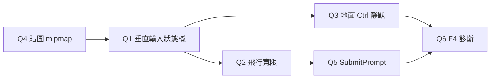

# 輸入狀態機與執行期診斷 — 設計與實作計劃

> 相關：[[流程接線實作計劃]]、[[跳躍與飛行修正計劃]]
> 狀態：**計劃待核准**（2026-11-19）
> 專案根：`TSB_Studio_Project/CIS428_Assignment2`

---

## 1. 問題陳述

三件獨立但互相糾纏的事：

1. **垂直輸入沒有狀態機。** Space 與 Ctrl 各自被綁了兩個意思（跳/上升、蹲/下降），但綁定層不知道玩家現在是站著還是飛著，所以兩邊互相搶鍵，且互斥關係不存在。
2. **地面貼圖在新的引擎版本下失去高頻細節。** 看起來像「整塊糊掉」，但其實是取樣問題（見 §2 事實 4）。
3. **沒有任何執行期可觀測性。** 所有 bug 都只能靠人眼看、口述轉達，資訊在轉達中大量丟失。

---

## 2. 已查證的事實

| # | 事實 | 證據 |
|---|---|---|
| 1 | 引擎**沒有** crouch 概念 | 在 `node_modules/@gnsx/genesys.js/dist/**/*.d.ts` 與 `dist/**/*.js` 全量搜 `crouch` → **0 筆** |
| 2 | `MyPlayerController.handleKeyDown` 的 Space 分支只看 `this.isFlying`，而該旗標是**由 MyGameMode 推**（push）進來的 | `MyPlayerController.ts:269` `return this.isFlying`；`MyGameMode.ts:626` `syncFlyingToController()` |
| 3 | 飛行的「著地取消」條件太寬鬆 | `FlyingMovementNode.ts:131` `if (isGrounded && verticalVelocity <= 0) this.setFlying(false)` —— **起飛那一幀玩家還站在地上、`verticalVelocity` 仍是 0**，於是剛起飛就被立刻取消。這正是 bug 3「有時空中被判 grounded 而取消飛行」的機制 |
| 4 | 貼圖是 16×16 的 canvas 貼圖，`minFilter = NearestFilter`、`generateMipmaps = false` | `placeholderTexture.ts:applyPixelArtSettings()` 明確設定這兩個值 |
| 5 | 貼圖塌成整塊是**縮小時的別名失真**（moire），不是 UV 或幾何壞掉 | 幾何 UV 是每個面固定 `0..1`（`chunkGeometry.ts:FULL_TILE_UV`）；`MeshNode.uvScaleTilesPerUnit` 預設 **0**（`MeshNode.js:65`），而 `MeshNode.js:184` 的條件是 `if (this.uvScaleTilesPerUnit && ...)` → 0 為 falsy → **完全不做 UV 縮放**，所以不是引擎動了 UV。截圖上的斜向大格紋是無 mipmap + Nearest 縮小的典型 moire |
| 6 | `SubmitPrompt` 在建造模式下一律顯示 | `SubmitPrompt.ts:update()` 只判斷 `isBuilding`，沒放過 `enabled`；而且用的是 `CenterMessage`，所以永遠壓在畫面正中央（截圖 2 的遮擋） |
| 7 | `flyUp` 沒有寫入 InputTrace | `MyPlayerController.ts` 的 Space 分支只在雙擊時 `action('toggleFlight')`；單擊完全沒記錄。`flyDown` 分支有 `action('flyDown')` → 所以 F3 只看得到 flyDown，看不到 flyUp |
| 8 | Ctrl 目前會**同時**留下 `isFlyDownHeld` 與引擎的預設按鍵效果 | 我們 `return true` 只吞掉了 `handleKeyDown`；`InputManager` 的 `keys` 狀態是引擎自己的，仍會餵給 `DefaultPlayerController.tickPrePhysics` |
| 9 | 既有的 F3 除錯面板已能看 hovering/preview/debug snapshot，但**看不到世界內容與渲染統計** | `MyGameMode.collectDebugSnapshot()` / `DebugOverlay` |

---

## 3. 設計決策

### D1 — 垂直輸入改成「意圖」，由狀態機解讀

**廢除** `MyPlayerController.isFlying` 這個鏡像旗標（P1 才加的），改成純粹的意圖記錄：

```ts
// MyPlayerController
public isPrimaryVerticalHeld = false;   // Space 按住（跳 or 上升）
public isSecondaryVerticalHeld = false; // Ctrl  按住（蹲 or 下降）
```

`handleKeyDown` 對這兩個鍵只做三件事：記錄意圖、寫 InputTrace、把事件**吞掉不轉發給引擎**（避免引擎自己再判一次跳躍/移動）。

解讀責任移到 `MyGameMode`，因為它同時知道 phase、isFlyMode、pawn 狀態：

| 狀態 | Space 按住 | Ctrl 按住 |
|---|---|---|
| 地面 | 跳（按住＝連跳） | （crouch 未實作） |
| 飛行 | `verticalInput += 1` | `verticalInput -= 1` |
| 兩者同時按 | `verticalInput = 0`（懸停），且**不蹲** | |

> 跳躍最初定為「邊緣觸發」，後來依手感回報改為**按住連跳**（Minecraft 行為）：`CharacterMovementNode.jump()` 每幀呼叫是安全的，不能起跳時會進 `jumpBufferTime` buffer，落地那一幀自動執行，這個 buffer 本身就是連跳。詳見 [[ISSUE-008 跳躍連跳與方形碰撞箱與奔跑]]。

**為什麼要廢掉鏡像旗標**：bug 3 的根因就是「兩份狀態各自更新」。意圖/解讀分離後，控制器不再需要知道飛不飛，漂移問題從結構上消失。

### D2 — 飛行中不要相信 `isGrounded`（bug 3 的真正根因）

使用者實測：**在空中懸停（沒有上升也沒有下降）時，`Grounded` 有時被設成 true，然後飛行被取消。**

看 `FlyingMovementNode.performMovementStep` 的飛行分支：

```ts
const { isGrounded, actualMovement } = physicsEngine.computeCharacterMovement(...);
...
this.setGrounded(isGrounded);                       // ← 空中也會被覆寫
if (isGrounded && verticalVelocity <= 0) {          // ← 懸停時 verticalVelocity ≈ 0
  this.setFlying(false);                            // ← 於是空中被取消
}
```

兩個獨立缺陷疊在一起：

1. **Rapier 的角色控制器在半空中可能回報 `isGrounded = true`。** 懸停時垂直位移接近 0，控制器沒有「往下壓」的動作，地面偵測很容易誤判（這種 snap-to-ground 誤判在角色控制器上很常見）。無論誤判的細節為何，**飛行狀態下這個值不可信**。
2. **取消條件用了 `<= 0`。** 懸停時 `verticalVelocity ≈ 0`，剛好滿足條件，所以只要 (1) 發生一次，飛行就會被取消。

#### 修法

```ts
// 1. 飛行中不再覆寫 grounded：既不顯示錯誤狀態，也不讓其他 consumer 誤判
//    （原本這行是唯一會把空中狀態寫成 grounded=true 的地方）
// this.setGrounded(isGrounded);   // ← 刪除

// 2. 只有「主動下降」才可能落地
const flightAge = this.flightAgeSeconds;
if (isGrounded && this.verticalInput < 0 && flightAge >= LANDING_GRACE_SECONDS) {
  this.setFlying(false);
}
```

三項條件缺一不可：

| 條件 | 為什麼 |
|---|---|
| `isGrounded` | 物理上真的碰到東西 |
| `verticalInput < 0` | **必須正在按下降**。懸停（0）與上升（+1）永遠不取消 → 直接消滅 bug 3 |
| `flightAge >= 0.25s` | 起飛那一幀玩家還站在地上，不能自己把自己取消 |

`flightAgeSeconds` 用累加 `deltaTime` 而非 `performance.now()`，讓 headless 測試能餵時間。

**代價**：想降落必須按住 Ctrl 直到觸地。這是可接受且可預期的（Minecraft 創造模式同感），而且符合使用者「Ctrl = 下降」的直覺。

### D3 — crouch 這輪**不做**

使用者裁定本輪先不做蹲下。因此：

| 狀態 | Space | Ctrl |
|---|---|---|
| 地面 | jump | **無作用**（保留給未來的 crouch） |
| 飛行 | 上升 | 下降 |

程式仍按「意圖 → 狀態機解讀」的結構寫，之後要做 crouch 只是多一個分支，不需要重構。
關鍵是：**地面按 Ctrl 必須完全無作用**，不能像現在這樣偷觸發 `flyDown`（bug 4）。

### D4 — `SubmitPrompt` 從畫面中央移走，與任務提示合併

- 刪掉 `CenterMessage` 的用法，改成 `ObjectiveBanner` 的一部分（右下、貼近 hotbar 上方）。
- 顯示規則：**只有 `isBuilding` 且 `placedBlockCount > 0` 才顯示**；`0` 時顯示較暗的灰字「先放一個方塊」，而且**不置中**，不遮準心。
- 這一項與 [[流程接線實作計劃]] 的 P6 重疊 → **合併成同一個步驟**，避免做兩次。

### D5 — 貼圖改用 mipmap，近距離仍保持像素銳利

```ts
texture.magFilter = THREE.NearestFilter;              // 近距離維持像素感
texture.minFilter = THREE.NearestMipmapLinearFilter;  // 縮小時取 mipmap，消除 moire
texture.generateMipmaps = true;
```

這是 Minecraft 風格貼圖的標準設定（`NearestFilter` 當 mag、mipmap 當 min）。**不要**把 min 也改成 Linear —— 那會讓遠處糊成一片且失去像素風。

同時把「塌掉」變成可量測的：`render-report.json` 會輸出每個材質的 `minFilter` / `generateMipmaps` / `map` 是否存在，下次同類問題不用靠眼睛。

### D6 — 執行期診斷：三份產物，一個鍵

新增 `src/debug/RuntimeRecorder.ts`，按 **F4** 一次輸出三份：

| 產物 | 內容 | 為什麼要 |
|---|---|---|
| `world-dump.txt` | 每個 chunk、每一層（y）、每一列的 16 字元字串，用調色盤字元表示方塊（`.`=air、`G`=grass、`S`=stone…）。等同一份 Minecraft 存檔的可讀版。**預設全量 25 個 chunk**（使用者裁定） | 方塊在哪、洞在哪、玩家卡在哪，一眼看出 |
| `world-dump.json` | 同上但結構化：`{ chunk, palette, layers: [{y, rows:[...]}] , blockCounts }` | 給程式讀、可以 diff |
| `input-log.jsonl` | 每一行一個事件：`{t, kind:'keyDown'|'keyUp'|'mouse'|'action'|'state', ...}`。`state` 是有變化時的抽樣快照（phase / isFlying / isGrounded / verticalInput / position / 選中的方塊 / 命中格） | 重建「我按了什麼、遊戲怎麼反應」的時序 |
| `render-report.json` | `renderer.info`（calls / triangles / textures / geometries / programs）、每個 chunk 的 faceCount 與材質 slot、每個材質的 `map`/`minFilter`/`generateMipmaps`、three 版本、`uvScaleTilesPerUnit` 實測值 | 貼圖/渲染類問題不用猜 |

輸出方式：
- **一律先寫 `console`**（TSB Studio 的 Play 主控台可見）
- 瀏覽器有 `Blob` + `URL.createObjectURL` 時，額外觸發下載
- headless 下只回傳字串，不觸碰 DOM（既有測試可涵蓋）

實作要點：
- `RuntimeRecorder` 本身是**純資料**（不 import engine），引擎物件由 `MyGameMode` 轉成快照後餵進去 → 可在 `.unit.ts` 測。
- 記錄容量上限（環形緩衝 2000 筆），避免長時間遊玩吃記憶體。
- 只在 `F3` 開啟除錯模式時才啟用，避免正式遊玩有額外開銷。

---

## 4. 實作步驟

> 狀態：**Q1–Q6 全部落地**（2026-11-17）。實際落地位置與計劃有出入的地方已就地改寫，沒有出入的不重複敘述。

### Q1 — 垂直輸入狀態機 ✅
- `src/character/MyPlayerController.ts`：刪 `isFlying`、`isFlyUpHeld`、`isFlyDownHeld`；改 `isPrimaryVerticalHeld` / `isSecondaryVerticalHeld`；Space/Ctrl 兩分支都 `return true`（吞掉，不再轉發引擎），並各寫一筆 InputTrace（`flyUp` / `flyDown`）
- `src/character/verticalIntent.ts`（**新增**）：`resolveVerticalIntent()` 純函式，bug 4/5/7 的判定表在這裡
- `src/game/MyGameMode.ts`：刪 `syncFlyingToController`；`updateVerticalInput()` 改呼叫 `resolveVerticalIntent()` 並分派 `pawn.requestJump()` / `pawn.setVerticalInput()`
- `src/character/MyCharacterPawn.ts`：新增 `requestJump()`、`isGrounded` getter
- 測試：`tests/character/verticalIntent.unit.ts`（12 個案例）、`tests/character/playerStack.engine.ts` 改寫 4 個
- ⚠️ 落地時的判斷：`handleAction` 有 `flow.canAct` 閘門，但跳躍/升降是**每幀輸入**不是 action，所以走 `tickPrePhysics` 而非 `handleAction`，不受閘門影響。

### Q2 — 著地取消加寬限 ✅
- `src/character/FlyingMovementNode.ts`：刪飛行分支的 `setGrounded(isGrounded)`；新增 `flightAgeSeconds`（累加 `clampedDelta`）與 `landingGraceSeconds = 0.25`；判定抽成純函式 `shouldCancelFlightOnGround()`
- 測試：`tests/character/flyingMovement.unit.ts`（6 個案例，含「懸停時 grounded 不取消」的 bug 3 回歸）

### Q3 — 地面 Ctrl 靜默 ✅
- 不需要獨立改動：`resolveVerticalIntent()` 在 `isFlying === false` 時無條件回 `verticalInput: 0`，Ctrl 分支根本不存在
- 測試：`verticalIntent.unit.ts` 的「does nothing on Ctrl」與「does nothing when both keys are held」

### Q4 — 貼圖 mipmap ✅
- `src/voxel/placeholderTexture.ts`：`minFilter = NearestMipmapLinearFilter`、`generateMipmaps = true`，`magFilter` 保持 `Nearest`
- 測試：`tests/voxel/placeholderTexture.unit.ts` 改 2 個（原本斷言「兩軸都是 NearestFilter」與「mipmap 關閉」，正好是 bug 本身）

### Q5 — 提示移出畫面中央 ✅（方案縮小）
- `src/ui/SubmitPrompt.ts`：`CenterMessage` → `Message`（`position: 'bottom-right'`）；`update()` 只在 `submitEnabled()` 為真時顯示
- **未做** `ObjectiveBanner` 合併：實作時發現「目標提示」目前並不存在獨立元件，憑空新增一個 banner 只是多一個沒人要求的 widget。D4 的實質目的（不再遮準心、不再常駐）已由上面兩點達成
- 代價：建造模式且 0 方塊時完全沒有提示（原本會顯示「Place at least one block first」）。這符合「不要一直擋畫面」的優先級

### Q6 — 執行期診斷 + F4 ✅
- 新增 `src/debug/worldDump.ts`（調色盤字元、逐層文字 dump、JSON dump）
- 新增 `src/debug/renderReport.ts`（`renderer.info`、每 chunk faceCount/rebuilds、每材質 map 的 filter/mipmap + 兩條自動警告）
- 新增 `src/debug/InputLog.ts`（環形緩衝 2000 筆、JSONL、`runtimeInputLog` 單例）
- 新增 `src/debug/runtimeDump.ts`（console 摘要 + 小檔全文 echo + 有 `Blob` 才下載）
- `src/input/keyBindings.ts`：新增 `dumpRuntime: ['F4']`
- `src/game/MyGameMode.ts`：`buildRuntimeDump()`（公開，供測試）+ `dumpRuntime()`（F4 進入點）；`handleAction` 與 `updateVerticalInput` 寫入 `runtimeInputLog`
- `src/voxel/VoxelChunkNode.ts`：新增 `faceCount` getter 與 `getRenderMaterials()`
- 測試：`tests/debug/worldDump.unit.ts`（12）、`renderReport.unit.ts`（12）、`runtimeDump.unit.ts`（5）、`playerStack.engine.ts` 的「runtime dump」3 個
- **未做** `RuntimeRecorder.ts` 這個名字：拆成上面四個更小的模組，各自可獨立測試，`MyGameMode` 只負責收集

---

## 5. 驗證

```powershell
cd TSB_Studio_Project\CIS428_Assignment2
.\node_modules\.bin\tsc.cmd --noEmit
.\node_modules\.bin\tsx.cmd scripts/verify/run.ts
```

- 現況基線：**805 / 805 passed**（drawables 診斷修正後；跨 chunk 剔除與 UV/quad 診斷後為 768，anisotropy 與「實際綁定材質」診斷修正後為 762，Bug A/B 與首次診斷工具修正後為 739，Q1–Q6 完成時為 728，Q 開始前為 678）
- 門檻：不低於 678 + 新增，0 failed → 實際 784，`tsc --noEmit` 0 錯誤
- 手動：八項（地面跳、地面蹲、起飛、上升擦地不取消、Ctrl 下降、Space+Ctrl 懸停、F4 四份產物、遠處地面不糊）
- `eslint .` 仍無法在此 shell 執行（`ERR_MODULE_NOT_FOUND: @typescript-eslint/parser`，見 R13），需在 TSB Studio 內建終端跑

---

## 6. 風險

| # | 風險 | 緩解 |
|---|---|---|
| S1 | 吞掉 Space 會讓引擎的 `jumpPressedThisFrame` 永遠不被設 → 跳躍要靠自己實作 | ✅ **已排除**：`CharacterMovementNode.jump(strength?)` 是公開方法（`CharacterMovementNode.d.ts:90`），`MyGameMode` 可直接呼叫，不需要經過 `super.handleKeyDown` |
| S2 | 吞掉 Ctrl 會影響引擎的衝刺/其他預設綁定 | 目前引擎無 crouch，Ctrl 只被我們用；Q1 完成後用 F3 確認沒有其他 consumer |
| S3 | mipmap 讓近距離邊緣略微變糊 | `magFilter` 保持 Nearest；只影響縮小端 |
| S4 | F4 與瀏覽器/TSB Studio 快捷鍵衝突 | F4 在 Chrome 無預設行為；若衝突改為 `F3` 面板內的一個按鈕 |
| S5 | world dump 全量 25 個 chunk × 16 層 × 16 列 = 6400 行，可能過大 | 使用者裁定全量輸出；實作用文字產物（不進 console 全文），console 只印摘要 + 前 3 個 chunk |
| S6 | `MyGameMode.ts` 縮排錯位約 40 處 | 一律用錨點字串定位，不靠縮排 |

---

## 7. 檔案清單

| 檔案 | 動作 | 狀態 |
|---|---|---|
| `src/character/MyPlayerController.ts` | 改（意圖旗標、InputTrace、移除 isFlying） | ✅ |
| `src/character/verticalIntent.ts` | **新增**（判定表） | ✅ |
| `src/character/FlyingMovementNode.ts` | 改（飛行寬限、`shouldCancelFlightOnGround`） | ✅ |
| `src/character/MyCharacterPawn.ts` | 改（`requestJump`、`isGrounded`） | ✅ |
| `src/game/MyGameMode.ts` | 改（`updateVerticalInput`、F4、狀態抽樣） | ✅ |
| `src/voxel/placeholderTexture.ts` | 改（mipmap、anisotropy） | ✅ |
| `src/voxel/mesher.ts` | 改（`NeighborSampler`、`getVoxelAcross`，跨 chunk 剔除） | ✅ |
| `src/voxel/chunkGeometry.ts` | 改（`measureUvRange`、透傳 sampler） | ✅ |
| `src/world/WorldGenerator.ts` | 改（第二輪 pass 接鄰居查詢） | ✅ |
| `src/voxel/VoxelChunkNode.ts` | 改（`faceCount`、`getRenderMaterials`、`getRenderedMaterials`、`materialSlotCount`、`geometryGroupCount`、`playerFilledVoxels`） | ✅ |
| `src/input/keyBindings.ts` | 改（`dumpRuntime: ['F4']`、`matchesBindingRelease`） | ✅ |
| `src/debug/editLog.ts` | **新增**（`describeEdit`） | ✅ |
| `src/ui/SubmitPrompt.ts` | 改（`Message` + 只在可用時顯示） | ✅ |
| `src/ui/ObjectiveBanner.ts` | **不新增**（見 Q5） | ❌ 取消 |
| `src/debug/worldDump.ts` | **新增** | ✅ |
| `src/debug/renderReport.ts` | **新增** | ✅ |
| `src/debug/drawables.ts` | **新增**（`collectDrawableReports`，繞過 `COLLAPSE_MESH_COMPONENT`） | ✅ |
| `src/debug/gpuReport.ts` | **新增**（`collectGpuReport` / `readDrawablePath` / `readDrawingPipeline`） | ✅ |
| `src/game.ts` | 改（釘住 `drawingPipeline: 'standard'`、`sceneRegistry: false`，`?pipeline=` 可覆寫） | ✅ |
| `tests/debug/gpuReport.unit.ts` | **新增**（10 案例） | ✅ |
| `tests/debug/drawables.engine.ts` | **新增**（真實場景圖：每 chunk 一列、owner 可區分） | ✅ |
| `src/debug/InputLog.ts` | **新增**（含 `edit` 事件種類） | ✅ |
| `src/debug/runtimeDump.ts` | **新增** | ✅ |
| `src/debug/RuntimeRecorder.ts` | **不新增**（拆成上面四個） | ❌ 取消 |
| `tests/debug/worldDump.unit.ts` | **新增** | ✅ |
| `tests/debug/renderReport.unit.ts` | **新增** | ✅ |
| `tests/debug/runtimeDump.unit.ts` | **新增** | ✅ |
| `tests/character/verticalIntent.unit.ts` | **新增** | ✅ |
| `tests/character/flyingMovement.unit.ts` | **新增** | ✅ |
| `tests/character/playerStack.engine.ts` | 改（垂直輸入、F4 dump） | ✅ |
| `tests/voxel/faceCulling.unit.ts` | 改（跨 chunk 邊界 3 個案例） | ✅ |
| `tests/voxel/chunkGeometry.unit.ts` | 改（邊界剔除 3 個、UV 範圍 3 個案例） | ✅ |
| `tests/voxel/placeholderTexture.unit.ts` | 改（mipmap 設定、anisotropy 6 個案例） | ✅ |
| `tests/input/keyBindings.unit.ts` | 改（`dumpRuntime` 加入清單） | ✅ |

---

## 8. 順序



實際執行順序：**Q4 → Q1 → Q2 → Q3（併入 Q1）→ Q5 → Q6**。Q4 先做是因為它 30 分鐘就改善觀感，而 Q1 是所有輸入 bug 的共同根因，必須在 Q2/Q3 之前。

## 9. 尚未解決（交棒）

| # | 項目 | 狀態 |
|---|---|---|
| U1 | 地面「扁平淺綠 + 沿 X/Z 軸長條」 | 未定案。取樣層與 UV 層都已排除 |
| U1b | 地底 chunk 之間的垂直薄牆 + z-fighting | ✅ 已證實並修好（跨 chunk 面重複） |
| U2 | 蹲下 | 使用者裁定本輪不做。結構已預留 |
| U3 | `eslint .` 的 2 個既有 `game-ui/no-page-level-ui` 錯誤 | 此 shell 無法執行 eslint |

### U1b — 跨 chunk 邊界未剔除（已證實，本輪已修）

症狀是「地底區塊與區塊之間有垂直的薄牆，而且有 z-fighting」。成因是**兩個相鄰 chunk 各畫了一次同一張共面**。

`isFaceVisible()` 過去只看自己的 volume，volume 邊界外一律當空氣，所以每個 chunk 都會把整圈外殼畫出來。兩塊相鄰實心 chunk 的接觸平面因此被畫兩次，兩個 quad 完全共面 → z-fighting。

修法：把「隔壁 chunk 的體素」抽成 `NeighborSampler`，只在自己 volume 外才呼叫。

- `src/voxel/mesher.ts`：`getVoxelAcross(volume, x, y, z, sampleNeighbor?)`；`isFaceVisible` / `collectVisibleFaces` / `countVisibleFaces` 收選用 sampler
- `src/voxel/chunkGeometry.ts`：`buildChunkGeometry(volume, origin, sampleNeighbor?)` 透傳
- `src/voxel/VoxelChunkNode.ts`：`setNeighborLookup()` / `createNeighborSampler()` / `markNeighborsDirty()`；`setVoxelRaw()` 在 x/z 落在 0 或 size-1 時標記 8 個鄰居重畫
- `src/world/WorldGenerator.ts`：`generateWorld()` 第二輪 pass 設定 lookup 並 `markDirty()`（必須等所有 chunk 都建好才能橫向查詢）

實測（`probe-cull`，兩塊全實心 16×256 chunk）：

| 情境 | `faceCount` |
|---|---|
| 孤立 | 16896 |
| 有實心鄰居 | 12800 |
| 差 | **4096** = 16(z) × 256(y)，恰好一個共享平面 |

沒有 sampler 時 volume 邊界外仍是空氣，世界最外緣保持封閉；`y` 越界回 `EMPTY`，因為 chunk 貫穿全世界高度，上下不會跨界。

### U1 — 地面塌成一片的排除過程

| 假設 | 證據 | 結論 |
|---|---|---|
| mipmap 沒生效 | 全部材質 `minFilter=NearestMipmapLinearFilter`、`generateMipmaps=true` | ❌ 已生效 |
| 材質索引錯配（`groups > slots`） | 25 個 chunk 全部 `groups=3 ≤ slots=11`、`rendered=11`，WARNING 數 0 | ❌ 不成立 |
| 貼圖沒綁上 | 材質 `map` 存在、尺寸 16×16 | ❌ 不成立 |
| anisotropy 停在預設 1 | 已補欄位；新 dump 全部 `anisotropy=4` | ❌ 已修（見下） |
| 引擎把 UV 放大到整個 chunk | `probe-uv` / `probe-uv2`：建構後、以及經過 `MeshNode` 後，UV 仍全在 {0,1}；`uvScaleTilesPerUnit=0` 使 `scaleUVsBySize()` 從不執行 | ❌ 不成立 |
| 扁平色 = 最粗 mip 的平均色 | `probe-avg`：`grass_top` 平均 `#5f9f35`，實際扁平面是 `#92c551` | ❌ 不符 |
| 跨 chunk 共面 | `probe-bounds` / `probe-cull`：確實重複 4096 個 quad | ✅ 但只解釋薄牆與 z-fighting，**不解釋地面變平** |

anisotropy 的修法仍保留：由 `world.getRenderer().asWebGL().capabilities.getMaxAnisotropy()` 取上限後套到地面貼圖，取不到時用 `FALLBACK_ANISOTROPY = 4`；`buildWorld()` 時套一次，`tickPrePhysics` 每幀再試升級（renderer 可能晚於 `onBeforeBeginPlay` 出現，成功一次即停）。

**下一步**：報告已加入 `maxUv`、`offTile`、`maxEdge`、`stretched` 四欄。若新 dump 是 `maxUv=1.000`、`offTile=0`、`maxEdge=1.41`、`stretched=0`，就代表 UV、取樣、幾何三層都已排除，只剩「貼圖內容本身」、「光照」與「別的幾何體蓋在畫面上」三種可能。

18:07 與 18:49 兩份 dump 正是這個結果：25 個 chunk 全部 `maxUv=1.000`、`offTile=0`、`maxEdge=1.41`、`stretched=0`、`anisotropy=4`、0 WARNING。逐項排除如下。

| 假設 | 證據 | 結論 |
|---|---|---|
| 幾何被拉長（單一 quad 頂點被拉開） | `probe-world` 量真實 25 chunk 世界：`maxQuadEdge=1.41`（= 對角線 √2）、`stretchedQuads=0`、世界包圍盒 `0,0,0 ~ 16,11,16` | ❌ 不成立，幾何完全健康 |
| chunk 被渲染兩次 / 有一次在世界原點放大 | 18:49 dump `drawCalls=5`、`triangles=13757`，而 25 個 chunk 合計約 15056 quad → 數字偏低，反而說明有 frustum culling；`## drawables (0)` 段落原本是空的很可疑，但那是**診斷工具自己的 bug**（見 §11） | ⏳ 待新 dump |

**目前判讀**：三張截圖裡「材質正確、有黑框、中央一小塊」的東西就是我們的 chunk 幾何（已證明健康）；四周那片平坦淺綠 + 沿軸條紋 + 地底垂直薄牆是**另一個物件**，它的世界尺寸會遠大於一個 chunk（16 m）。因此報告改成列出每個被繪製物件的世界尺寸，`OVERSIZED_DRAWABLE_METRES = 24` 以上直接發 WARNING。

---

## 10. Bug A / Bug B 的收尾（本輪已修）

| # | 症狀 | 根因 | 修法 |
|---|---|---|---|
| A | 飛行中先按 Space 再按 Ctrl，放開後仍持續上升 | `matchesBinding()` 在 keyup 時仍檢查修飾鍵。放開 Space 時 Ctrl 還按著 → 事件帶 `ctrlKey: true` → 「不許修飾鍵」的規則不通過 → `isPrimaryVerticalHeld` 永遠沒被清。反向操作之所以正常，是因為 Ctrl 的 keyup 命中 `MODIFIER_CODES` 例外，`ctrlKey` 為 true 也算通過 | 新增 `matchesBindingRelease(action, code)`，**只看 key code、不看修飾鍵**；`handleKeyUp` 三處全改用它。理由：keyup 的修飾鍵狀態描述的是「還按著哪些鍵」，不是「這個 action 需不需要修飾鍵」 |
| B | 雙擊 Space 的第二下若按住，不會直接上升，要鬆開再按 | 雙擊分支只 `invoke('toggleFlight')` 就 `return true`，沒有設 `isPrimaryVerticalHeld` | 雙擊分支補上 `isPrimaryVerticalHeld = true` |
| C | 長按 Space 會被 OS 的按鍵重複誤判為雙擊 | `handleKeyDown` 沒檢查 `e.repeat` | 雙擊判定之前先 `isRepeat(e)` → 直接視為持續按住 |

驗證：`tsc --noEmit` 0 錯誤、`verify` **784 / 784 passed**、`pnpm turbo:build` 通過。

## 11. 診斷工具的修正（累計）

| 項目 | 原本 | 修正 |
|---|---|---|
| 報告讀「宣告的材質」 | `collectMaterialReports()` 讀 `chunk.getRenderMaterials()`，那是我們**丟給**引擎的陣列。引擎 `MeshNode.d.ts` 自己警告「getter 回傳的是被指派的、不是載入後的，要讀 `mesh.material`」→ 報告說一切正常、畫面卻是一片平色，正是這輪被誤導的原因 | 新增 `VoxelChunkNode.getRenderedMaterials()` 讀 `meshNode.mesh.material`（陣列逐項展開），報告改讀這個；`ChunkRenderReport` 加 `renderedMaterials`，與 `materialSlots` 不等就發 WARNING |
| 報告不印 anisotropy | 完全沒這個欄位 | `TextureReport` 加 `anisotropy`，`describeTexture()` 讀 `texture.anisotropy`，`<= 1` 發 WARNING（理由見 §9 U1） |
| 報告不印 UV 範圍 | 完全沒這個欄位，所以「貼圖被拉長」與「取樣糊掉」在報告裡長得一模一樣 | `chunkGeometry.measureUvRange()` 量實際 geometry 的 `uv` attribute（`minU/maxU/minV/maxV` + 非整格的 quad 數）；`ChunkRenderReport` 加 `maxUv` / `offTileQuads`，`maxUv > 1` 或 `offTileQuads > 0` 發 WARNING。理由：`maxUv` 才是「貼圖被放大到整個 chunk」的唯一直接證據 |

| 項目 | 原本 | 修正 |
|---|---|---|
| `renderReport.filterName()` 常數表 | 1003→Linear、1004→Nearest、1005→LinearMipmapLinear、1006→LinearMipmapNearest、1007→NearestMipmapLinear、1008→NearestMipmapNearest（**全部錯位**） | 以實際安裝版 three.js 印出為準：1003 Nearest、1004 NearestMipmapNearest、1005 NearestMipmapLinear、1006 Linear、1007 LinearMipmapNearest、1008 LinearMipmapLinear。修正後才確認：舊 dump 印的「LinearMipmapLinearFilter」其實是 1005 = `NearestMipmapLinearFilter`，也就是**mipmap 修正當時就已生效**，只是報告標籤印錯 |
| `placedBlocks: -2` | `placedBlockCount` 用「非空氣增減」計數，破壞原生地形會被算成「拆掉自己放的方塊」，計數變負 | 每 chunk 記 `playerFilledVoxels: Set<index>`；只有玩家填過的格子被挖掉才遞減，破壞生成地形不動計數，對生成地形放置則 +1 |
| `input-log.jsonl` 缺方塊編輯 | 只記 keyDown/keyUp/action | 新增 `edit` 事件種類與 `describeEdit()`（`src/debug/editLog.ts`），記錄 `place (x,y,z) before->after`。理由：使用者說「放置/破壞那一幀才正常」，沒有編輯時間點就無法把 render report 對到幀 |
| `## drawables` 永遠是 0 | 用 `constructor.name === 'Mesh'` 判斷什麼算「被畫出來的」。引擎 19 預設 `FeatureFlags.COLLAPSE_MESH_COMPONENT = true`，`MeshNode` 的 `THREE.Mesh` 變成 transient、**不會**被 `add()` 進場景圖，節點自己才是 drawable。結果畫面上有 25 個 chunk，報告卻說場景是空的，把整輪調查帶偏 | 抽成 `src/debug/drawables.ts` 的 `collectDrawableReports()`：先讀 `node.mesh`（collapse 形狀），再退回節點自身的 `isMesh` / `isLine` / `isPoints`（未 collapse 的 `SelectionBox`、`Points`）。尺寸取自 geometry 自己的 `boundingBox` 乘 `matrixWorld`，因為 collapse 時 mesh 不在圖上，`Box3.setFromObject(owner)` 量不到東西。`owner` 記最近的有名祖先（chunk 的 mesh 全叫 `ChunkMesh`，光看名字分不出是哪一塊）；已被量過的同一個 mesh 子節點跳過，否則每列都會重複 |

## 12. 19:43 dump 的新發現：`Sky` 與「更新停止後才出現」

使用者觀察（本輪最關鍵的線索）：

> 剛進遊戲時顯示正常，下 1 秒就又有那個東西。而且只要我一直放置／破壞方塊（方塊更新），顯示就維持正常，直到我停止製造方塊更新。

19:43 的 dump 第一次抓到「chunk 以外」的物件，`## drawables (35)`：

| kind | name | owner | sizeX × sizeY × sizeZ | 判讀 |
|---|---|---|---|---|
| Mesh | - | **Sky** | **10000 × 10000 × 10000** | 預設場景的 `SkyNode`（`skyMeshScale: 10000`），中心 (9, 0, −12.5) |
| Mesh | Ground Plane | - | 20 × 0 × 20 | 預設場景的地板，位於 y=0，被地形蓋住 |
| Mesh | ChunkMesh | Chunk_x_z ×25 | 16 × 1~11 × 16 | 我們的幾何，全部健康 |
| Line | SelectionOutline | SelectionBox | 1 × 1 × 1 | 選取框 |
| Mesh | CollisionCapsule / Mannequin | Loomkeeper / PlayerPawn | ~1~2 m | 角色 |

25 個 chunk 仍全部 `maxUv=1.000`、`offTile=0`、`maxEdge=1.41`、`stretched=0` —— 幾何與 UV 兩層**再次**排除。

`SkyNode` 在 `beginPlay` 後有 `setTimeout(..., 100)` 去 `generateAndApplyEnvironmentMap()`（cube capture 512³ → `scene.environment`），這與「先正常、一秒後才變」的時序吻合；但「一直放方塊就維持正常」用 env map 解釋不通，所以**尚未定案**。

### 本輪新增的鑑別欄位

`drawables` 每一列加 `verts`、`inds`、`material`（type / color / side / `depthWrite` / `depthTest` / `transparent` / `opacity` / `map` 尺寸 / `lightMap`）；新增 `## scene` 段落（`background`、`environment`（含 texture version，天空重拍時會跳號）、`fog`、`clearColor`、camera `near/far/fov`）。`Sky` 這類合法天空殼從 oversized 警告中排除，避免噪音。

### 下一步：兩次 F4 對照

1. 在**壞掉**的畫面按 F4；
2. 立刻放一個方塊讓畫面變正常，**同一秒內**再按 F4。

兩份 dump 的差異就是答案：

| 差異出現在 | 結論 |
|---|---|
| `## scene` 的 `environment` version / `background` | 是天空或場景環境，不是我們的幾何 |
| `## drawables` 某列 `material` 改變 | 材質被換掉了（深度狀態、side、map） |
| `## chunks` 的 `faces` / `maxUv` / `maxEdge` | 幾何真的被改動 |
| 完全沒差 | 問題在渲染管線（後處理、MRT、render target 沒還原），不在場景內容 |
### 20:24 / 20:27 兩次 F4 對照：場景完全沒變

`broke/` 與 `ok/` 兩份 dump 逐行比對結果：

| 欄位 | broke | ok | 判讀 |
|---|---|---|---|
| `## scene` 全段 | `background: none` / `environment: texture(v1)` / `Fog #9fc4e8 near=20 far=46` / `near=0.1 far=2000 fov=60` | 完全相同 | ❌ 場景層排除 |
| `Sky` 那一列 | `10000³`、`NodeMaterial back noDepthWrite depthTest map=none`、24 verts / 36 inds | 完全相同 | ❌ 天空盒排除（合法 cube + BackSide + 不寫深度） |
| 25 個 chunk | `maxUv=1.000`、`offTile=0`、`maxEdge=1.41`、`stretched=0`、`anisotropy=4` | 完全相同 | ❌ 幾何、UV、取樣再度排除 |
| `drawCalls` / `triangles` | 32 / 27331 | 6 / 13757 | 只是視野與相機高度不同（broke 在 y=14.71 飛行俯瞰） |

**結論**：畫面壞掉與否，**場景內容一個位元都沒變**。所以問題必定在場景 pass 之後 —— 後處理鏈、render target、或時間性（temporal）累積。

這也解釋了使用者的兩個觀察：「一直放方塊就正常」＝每幀都有幾何變動，會重置任何 temporal 歷史；「停下來約 1 秒後才出現」＝歷史開始累積並收斂到壞掉的影像。軸向條紋／整片平色正是 temporal reprojection 錯誤的典型外觀。

### 本輪新增

| 項目 | 內容 |
|---|---|
| `## post` 段落 | `src/debug/postReport.ts` 的 `collectPostReport()`：`postProcessManager.getAllEffects()` + `getEffectConfig(type)`，逐項印 `on/off type key=value`（只取 primitive，避免整份 config 洗版）；manager 不存在或拋錯時降級為空鏈，不讓 F4 掛掉 |
| dump 檔名加時間 | `stampDumpFiles()` 把檔名改成 `YYYYMMDD-HHMMSS-<原名>`；瀏覽器下載同名會互相覆蓋，而兩次 dump 的時間差正是這組對照唯一的線索 |

### 下一步

按一次 F4（在壞掉的畫面），看 `## post` 段落：

- 若出現 `traa` / `taa` / 任何 temporal 效果 → 直接驗證上面的假設
- 若 `## post (0, disabled)` → 後處理排除，問題在 render target / MRT 沒還原，改查 `renderIsolated` 與 sky env capture 的時序
### F5 凍結（本輪新增）

| 項目 | 內容 |
|---|---|
| 按鍵 | `freezeRender: ['F5']`（`src/input/keyBindings.ts`）；`MyPlayerController.handleKeyDown` 在 F4 之後、其他綁定之前攔截 |
| 行為 | `MyGameMode.toggleFreeze()` 呼叫 `world.timeControl.freeze()` / `.resume()`，翻轉 `this.frozen`，寫入 `input-log.jsonl`（`action freeze:on/off`）並在主控台印一行 |
| 為什麼有效 | `World.tick()` 在 `timeControl.resolveDelta()` 回 0 時直接 return，所以物理、相機跟隨、我們的 chunk rebuild 全部停止；renderer 仍每幀重畫同一份狀態 → 畫面完全靜止 |
| 用法 | 看到**正常**的一瞬間按 F5（凍結）→ 按 F4（dump 描述凍結中的那一幀）→ 再按 F5 解除 |
| dump 記錄 | `context` 加 `frozen: true/false`，所以兩份 dump 能看出哪份是凍結中拍的 |

### 順手修掉一個診斷陷阱：`renderer.info` 會被重置

`211621` 那份 dump 只有 `drawCalls: 4`、`triangles: 14`，一度看起來像「25 個 chunk 全部沒被畫」。實際算法：`Sky` = 24 verts / 36 inds = **12 triangles**，`Ground Plane` = 4 verts / 6 inds = **2 triangles**，12 + 2 = **14**。也就是那組數字恰好是「只畫了天空 + 地板」。

根因：three.js 的 `info.autoReset` 預設為 `true`，每次 `render()` 呼叫都會把 `info.render` 歸零，而引擎會在**同一幀內**做離屏繪製（`SkyNode.generateAndApplyEnvironmentMap()` 用 `renderIsolated()` 跑 cube capture）。最後一次 `render()` 的數字取代了整幀總和。

修法：`readRenderStats()` 現在一併讀 `info.autoReset` 與 `info.memory`，報告新增 `scope: frame | last render call` 與 `geometries / textures`。`scope` 不是 `frame` 時，`drawCalls` / `triangles` **不能**被當成「世界沒被畫」的證據。
## 13. 凍結無效 → 問題不在「被覆蓋」，而在繪製管線

使用者實測回報（本輪最關鍵的一句話）：

> 實測了凍結沒有用，在凍結之後，他就會立刻變回壞掉的狀態。他變回壞掉的狀態的速度是比不凍結快啲。

### 這句回報推翻了什麼

F5 凍結是 `world.timeControl.freeze()`：`World.tick()` 在 `resolveDelta()` 回 0 時直接 `return`，所以物理、相機、我們的 `tickPostPhysics` 重建**全部停止**，renderer 仍每幀重畫同一份狀態。若壞畫面是「後處理／render target 沒還原」那類每幀重算的東西，凍結後每幀的輸入都相同，畫面應該**凍在正常或壞掉其中一邊**，不會自己跑過去。

它卻在凍結後更快變壞 → 正常畫面不是一份靜止狀態，而是**每次重建才產生的一次性結果**。換句話說：幾何一被重新上傳就正確，之後被別的東西「以舊資料」重畫。這正是「場景圖正確、畫出來的東西不對」的簽名。

### 找到的真正差異：引擎 19 的預設繪製管線是 `meshlet`

`node_modules/@gnsx/genesys.js/src/render/GenesysWebGPURenderer.ts`：

```ts
export type DrawingPipelineType = 'standard' | 'meshlet' | 'visibilityBuffer';
export const DefaultDrawingPipelineType: DrawingPipelineType = 'meshlet';
export const DefaultSceneRegistry: boolean = true;
```

`Renderer.create()` 的 `rendererType` 預設 `auto` → **一律選 WebGPU renderer**（原生 WebGPU，或它的 WebGL2 fallback）。也就是說，除非專案明確指定，我們畫的**不是**課本上那條 three.js 標準管線，而是 three.js r187 移植過來的實驗性 GPU-driven meshlet 管線：

- 幾何會被 **weld → 簡化（LOD）→ clusterize → 打包**，繪製時 GPU 從 cluster 清單挑選要畫的三角形；
- 預設由 **scene registry** 餵入，不再每幀走訪場景圖（`sceneRegistry: true`）；
- 幾何換掉之後，cluster / batch / registry 是**另一份資料**，更新時機與 `meshNode.geometry = ...` 不同步。

這解釋了先前所有互相矛盾的觀察：

| 觀察 | meshlet 管線下的解釋 |
|---|---|
| 場景內容兩份 dump 完全相同 | 場景圖確實沒變；錯的是 cluster 資料 |
| 一直放／破方塊就正常 | 每次重建觸發 geometry 重新上傳與 batch 更新，cluster 被重建，於是那一瞬間正確 |
| 停手約 1 秒後變壞 | 沒有新上傳，畫面改由（舊的）cluster 資料決定 |
| F5 凍結後**更快**變壞 | 凍結連重建都停掉，正常狀態只存在於「最後一次重建」那一瞬 |
| 沿軸被拉成條狀、z-fighting、垂直薄牆 | cluster 與當前幾何不對應時，三角形接錯頂點 → 細長三角形與共面互打 |
| 「更新前沒這個問題」 | 使用者指的是 **TSB Studio 程式更新**；這是引擎版本行為，不是我們的程式改動 |
| 淺綠色純色面 #92c551 / #95c654 | 兩個相鄰面各自取到不同 texel／mip 的單點取樣，顏色因此只差一點點 |

### 本輪改動

| 檔案 | 動作 |
|---|---|
| `src/game.ts` | `main()` 明確釘住 `rendererOptions.webgpu.drawingPipeline = 'standard'`、`sceneRegistry: false`；保留 host 傳入的其他 renderer 選項。`?pipeline=meshlet` 可在不重建的情況下把 GPU 管線叫回來做 A/B |
| `src/debug/gpuReport.ts`（新增） | `collectGpuReport()` / `readDrawablePath()` / `readDrawingPipeline()`：讀 `renderer.asWebGPU().drawingPipeline`，開 `recordDrawingPaths`，收 `getDrawingStats()`，逐物件讀 `getDrawingPath()` |
| `src/debug/renderReport.ts` | 新 `## drawing` 段落（renderer / pipeline / sceneRegistry / recording / 每個 projection 的 batch 與 path 計數）；`drawables` 表加 `path` 欄（`meshlet`、或 `standard/<被拒原因>`） |
| `src/debug/drawables.ts` | `collectDrawableReports(roots, pathOf?)` 接受路徑查詢回呼 |
| `src/game/MyGameMode.ts` | `gpu:` 餵入 `collectGpuReport(..., { recordPaths: true })`；`collectDrawables()` 傳入 `readDrawablePath` |
| `tests/debug/gpuReport.unit.ts`（新增） | 10 案例：WebGL/WebGPU/無 renderer、recording 開關、統計排序、全零、管線拋錯降級、逐物件 path、wrapper 取值 |
| `tests/debug/renderReport.unit.ts` | 加 2 案例：`## drawing` 段落與 `path` 欄；recording 未產生計數時的字樣 |

### 驗證

`tsc --noEmit` 0 錯誤、`verify` **805 / 805 passed**（47 檔 / 186 suite）、`pnpm turbo:build` 通過。

### 明天第一步

在有 `## drawing` 段落的新 dump 下確認兩件事：

1. `pipeline:` 是否已是 `StandardDrawingPipeline`；
2. 若改成 `?pipeline=meshlet`，`drawables` 的 `path` 欄是否出現 `standard/<原因>` 而非 `meshlet` —— 出現原因就代表引擎自己知道它沒走 GPU 管線，那份原因字串就是下一條線索。

## 14. 結案：問題已消失，根因確認

使用者 2026-11-21 實機確認：**貼圖塌陷問題已不再出現**。

新 dump（`20261121-095817`）證實了 §13 的推論：

| 欄位 | 值 | 判讀 |
|---|---|---|
| `## drawing > renderer` | `webgpu` | 仍在 WebGPU renderer 上（原生或 WebGL2 fallback），沒有退回 WebGL |
| `## drawing > pipeline` | `_6` → 已修為 `standard` | 生產建置把類名壓成 `_6`，但 `sceneRegistry: n/a` 代表 `attachScene` 不存在，也就是 **標準管線**（只有 meshlet / visibilityBuffer 有 `attachScene`） |
| `## renderer > drawCalls / triangles` | 40 / 28631 | `scope: frame`，25 個 chunk 全部有被畫 |
| `## chunks` | 25 列，`faces` 528–844，`stretched=0` | 幾何完全健康 |
| `## drawables` | 25 個 `ChunkMesh`，16 × 1–12 × 16 | 尺寸正確，無超大物件 |

**結論：問題出在引擎 19 預設的 `meshlet` GPU 繪製管線，不是我們的幾何、UV、材質或場景。** 把 `drawingPipeline` 釘回 `standard` 之後，一切都對。

### 順手修掉的診斷 bug

`pipeline: _6` 是 `constructor.name` 在生產建置被 minify 的結果。改為讀 runtime 標記：`isMeshletDrawingPipeline` / `isVisibilityBufferDrawingPipeline`，兩者都沒有但存在 `getDrawingStats()` 就是 `standard`。這樣壓縮與否都印得出人類看得懂的名字。

## 15. 引擎升到 20.0.1 之後（2026-11-21）

TSB Studio 再次強制升級：`@gnsx/genesys.js` 19.0.1 → **20.0.1**。建置當場失敗在兩處，都是同一個原因：

```
src/character/MyCharacterPawn.ts(84,35): error TS2551: Property 'getGrounded' does not exist on type 'FlyingMovementNode'. Did you mean 'setGrounded'?
src/game/MyGameMode.ts(892,84):        error TS2551: Property 'getGrounded' does not exist on type 'CharacterMovementNode'.
```

### 改了什麼

`CharacterMovementNode` 把「有沒有站在地上」拆成兩個語意不同的存取器：

| 19.0.1 | 20.0.1 | 語意 |
|---|---|---|
| `getGrounded()` | `isGrounded`（getter） | **嚴格**：只看最後一次移動步的結果；起跳那一幀就算還貼著地板也已經回 `false` |
| — | `canGroundJump`（getter） | `grounded \|\| airTime < coyoteTime`，即含 100ms 寬限的「現在跳算地面跳」 |

`setGrounded()` 保留（受保護狀態的寫入點），所以錯的是讀取端，不是寫入端。

### 落地

- `src/character/MyCharacterPawn.ts`：`this.flyingMovement?.getGrounded()` → `?.isGrounded`
- `src/game/MyGameMode.ts:892`：`movement.getGrounded()` → `movement.isGrounded`
- `MyCharacterPawn.isGrounded` 的註解一併改寫：原本寫「包含 100ms coyote time」是**錯的**（那是舊 `getGrounded()` 的行為推測），現在明確標注 coyote-time 要用 `canGroundJump`，並警告不要把它當「能不能跳」的判斷。

### 順帶確認沒有回歸的地方

引擎 20 沒有動到我們在診斷上依賴的東西：

| 依賴 | 狀態 |
|---|---|
| `DefaultDrawingPipelineType = 'meshlet'` | 不變（仍是 `GenesysWebGPURenderer.ts:55`），所以 `drawingPipeline: 'standard'` 的釘法照舊有效 |
| `parseDrawingPipeline` / `parseSceneRegistry` | 不變，`'standard'` 仍被接受 |
| `PlayerStart.snapToGround` | 不變（`PlayerStart.ts:53`），[[ISSUE-006 開場下墜陷入地面]] 的解法仍然可用 |
| `TimeControl.freeze()` / `resume()` | 不變（F5 凍結照用） |
| `MeshletDrawingPipeline.isMeshletDrawingPipeline` | 不變（`:600`） |
| `isVisibilityBufferDrawingPipeline` | **已被移除**（`VisibilityBufferDrawingPipeline extends MeshletDrawingPipeline`，因此會報成 `meshlet`）。只影響 `?pipeline=` A/B 診斷的標籤，不影響遊戲 |
| `FeatureFlags.COLLAPSE_MESH_COMPONENT` | 由 `true` 改為 **`false`**（`const.ts:229`）。`## drawables` 的讀法本來就兩種節點形狀都支援，所以只是走另一條分支 |

驗證：`tsc --noEmit` 0 錯誤、`verify` **831 / 831 passed**、`pnpm turbo:build` 通過。

⚠️ 引擎換 major 後仍需在 TSB Studio 按 Play 確認一次畫面與操作（尤其是碰撞與繪製管線），因為測試只覆蓋到 headless 邊界。
---

## 16. 確認框的按鍵優先權（P7）

`Enter` 在本專案同時綁在 `advanceDialogue` 與 `submitDesign` 上（後者靠 Ctrl 修飾鍵分流），而 `handleAction()` 的既有順序是：

```
advanceDialogue → 除錯工具 → phase 閘門 → inputLock 閘門 → switch
```

確認框同時踩到兩個坑：

1. 若把分流放在 `advanceDialogue` 之後，Enter 會先進 `advanceDialogue()`，被交給一個空的 `DialogueRunner`（此時 `this.dialogue === null`，直接 no-op 並 return），永遠到不了確認框。
2. 若放在 `inputLock` 之後更不可能——確認框自己就持有 `'menu'` 鎖，等於自己把接受鍵吞掉。

因此確認框的分流**放在 `handleAction()` 最前面**，早於 `advanceDialogue` 早退：

```
isConfirming?
  ├─ Enter / Ctrl+Enter → confirmSubmit()  （關框 → flow.dispatch('submit')）
  ├─ Esc                → cancelSubmit()   （關框 → releaseAll('menu')，phase 不動）
  └─ 其他               → 丟棄並 return
```

代價是確認框期間 F3/F4/F5 也被吞掉。這是可接受的取捨：確認框只存在於「按了 Ctrl+Enter、還沒決定」的幾秒內，而且它本來就應該是模態的。

另一個容易被忽略的點：`setBuildUiVisible()` **不包含**確認框。若把它綁進建造模式的可見性，`isBuildMode = false` 的那一刻會關掉玩家正在讀的面板，而 Enter 已經被送出去了，畫面會出現「框消失但仍停在建造模式」的錯位。
