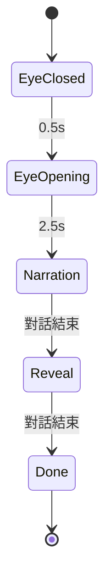

# P1 過場系統

> 狀態：🟡 待討論
> 對應遊戲節點：[[N1 眼睛睜開濾鏡]]、[[N2 環境描述對話]]、[[N3 織界者現身]]
> 相關文件：`level_plans/05_build_mode_genesys.md` §5.9

## 目標

實作開場過場：眼睛睜開 → 環境描述 → 織界者現身 → 對話。

## 技術架構

```
IntroSequenceController (TypeScript)
├── Phase 1: EyeOpenEffect
│   ├── 黑幕 overlay（HTML）
│   ├── 眼形遮罩（clip-path）
│   └── 2.5 秒漸變
├── Phase 2: EnvironmentNarration
│   ├── 打字機對話框
│   └── 環境描述文字
└── Phase 3: LoomkeeperReveal
    ├── 相機轉向（玩家轉頭，第一人稱）
    ├── 織界者名稱切換（??? → 織界者）
    └── 對話序列
```

> **角色分工**：玩家 = Steve 風格方塊人（第一人稱隱藏自身模型）；織界者 = NPC（永遠可見）。
> 詳見 [[P4 角色系統#角色分工（重要）]]。

## 關鍵實作

### 黑幕 overlay

```typescript
// 必須加到 world.gameContainer，不可加到 document root
const overlay = document.createElement('div');
overlay.style.cssText = `
  position: absolute; inset: 0;
  background: #000; z-index: 1000;
  transition: opacity 2.5s ease-in-out;
`;
world.gameContainer.appendChild(overlay);

// 淡出
requestAnimationFrame(() => { overlay.style.opacity = '0'; });
```

### 眼形遮罩

```css
.eye-mask {
  position: absolute; inset: 0;
  background: #000;
  clip-path: ellipse(50% 0% at 50% 50%);
  transition: clip-path 2.5s ease-in-out;
}
.eye-mask.open {
  clip-path: ellipse(50% 50% at 50% 50%);
}
```

### 相機轉向

**已定案：轉頭 = 玩家轉頭**（第一人稱視角下轉相機），**不用** `TweenMovementNode` 旋轉相機節點。

```typescript
// 第一人稱：直接對 pawn 的 cameraPivot 做 yaw 補間
const pawn = world.getFirstPlayerPawn();
const pivot = pawn?.getNodeByName<ENGINE.SceneNode>('CameraPivot');
if (!pivot) return;

// world.tweenManager.createTween() 回傳 TWEEN.Tween，需 .start()
world.tweenManager
  .createTween(pivot.rotation)
  .to({ y: targetYaw }, 1500)
  .easing(TWEEN.Easing.Cubic.InOut)
  .start(world.tweenManager.getCurrentTime());
```

> ⚠️ 過場期間必須 `world.gameLoop.setInputEnabled(false)`，否則玩家滑鼠會與 tween 打架。
> ⚠️ `createTween()` 只建立並追蹤，**必須呼叫 `.start()`** 才會播放。

## 狀態機



## 待確認

- [ ] 環境描述的具體文字？
- [ ] 織界者的具體台詞？
- [ ] 要不要加背景音效（環境音、心跳聲）？
- [ ] 醒來位置在哪？

## 風險

| 風險 | 緩解 |
|---|---|
| HTML overlay 蓋住 UI | 用 `z-index` 分層，過場結束後 `remove()` |
| 相機切換衝突 | 用 `pushViewTargetCamera` 堆疊，結束時 `removeViewTargetCamera` |
| 玩家提前解鎖 | 全程 `setInputEnabled(false)`，結束才 `true` |