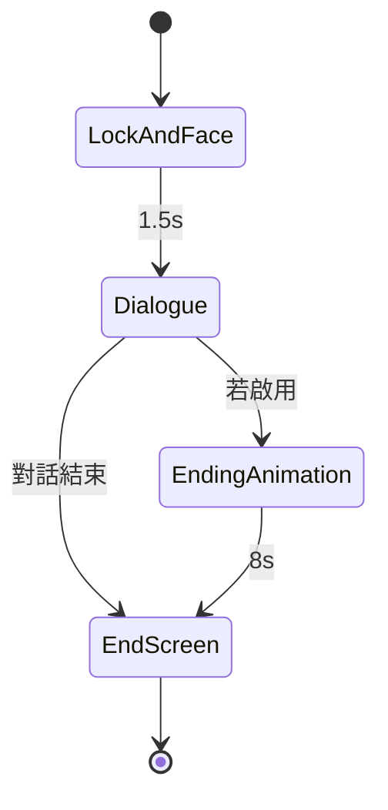

# P3 結束系統

> 狀態：✅ 已完成（Demo 前範圍）
> 對應遊戲節點：[[N10 織界者對話]]、[[N11 結束動畫]]、[[N12 遊戲結束]]
> 相關文件：`level_plans/04_demo_scope_genesys.md`

## 目標

實作結束流程：Submit 區塊 → 織界者對話 → 結束動畫 → 遊戲結束畫面。

> ⚠️ 原本的「進度滿（3/3）」已移除，改為 **Submit 機制**（見 [[N9 Submit 區塊]]）。

## 技術架構

```
EndingSequenceController (TypeScript)
├── Phase 1: LockAndFace
│   ├── world.gameLoop.setInputEnabled(false)
│   ├── 玩家視角平滑轉向織界者（第一人稱轉 cameraPivot）
│   └── 織界者平滑轉向玩家
├── Phase 2: Dialogue
│   └── 織界者台詞（ChatMessage）
├── Phase 3: EndingAnimation（暫緩）
│   ├── 粒子效果
│   ├── Bloom 後處理
│   └── 環繞運鏡
└── Phase 4: EndScreen
    ├── CenterMessage.show()
    ├── 製作名單（credits）
    └── 統計資料（待定）
```

## 關鍵實作

### 對望運鏡（已定案：過場模式平滑互望）

**不做**切換到第三人稱機位 —— 保持第一人稱，只把 `cameraPivot` 的 yaw 平滑轉向織界者。

```typescript
const pawn = world.getFirstPlayerPawn();
const pivot = pawn?.getNodeByName<ENGINE.SceneNode>('CameraPivot');
const loom = world.getNodeByName('Loomkeeper');
if (!pivot || !loom) return;

const playerPos = pawn!.getWorldPosition();
const loomPos = loom.getWorldPosition();
const targetYaw = Math.atan2(loomPos.x - playerPos.x, loomPos.z - playerPos.z);

world.tweenManager
  .createTween(pivot.rotation)
  .to({ y: targetYaw }, 1500)
  .easing(TWEEN.Easing.Cubic.InOut)
  .start(world.tweenManager.getCurrentTime());
```

### 織界者轉向

```typescript
const loom = world.getNodeByName('Loomkeeper');
const playerPos = world.getFirstPlayerPawn()!.getWorldPosition();
const loomPos = loom!.getWorldPosition();
const targetYaw = Math.atan2(playerPos.x - loomPos.x, playerPos.z - loomPos.z);

world.tweenManager
  .createTween(loom!.rotation)
  .to({ y: targetYaw }, 1000)
  .easing(TWEEN.Easing.Cubic.InOut)
  .start(world.tweenManager.getCurrentTime());
```

### 結束畫面

`src/cinematic/EndCard.ts` 封裝全部文案，`CenterMessage` 只負責顯示。

```typescript
const card = new ENGINE.CenterMessage(ui, { customStyles: { 'white-space': 'pre-line' } });
await card.initialize();
card.show({ title: END_CARD_TITLE, subtitle: buildEndCardSubtitle(blockCount), duration: 0 });
```

- `duration: 0` 是刻意的：卡片留在畫面上直到使用者離開 play，不會自動消失
- `white-space: pre-line` 是必要的：`CenterMessage.show()` 對 subtitle 用 `textContent`，而引擎的 `center-message.css` 沒設 `white-space`，`\n` 會被壓成空格，四行 credits 會擠成一行
- 卡片內容：標題 → coda → 方塊數 → 四行 credits，中間用空行分組

**由 phase 驅動，不是由 timeline step 驅動**

```typescript
// MyGameMode.onPhaseChanged
if (to === 'ended') {
  this.overlay.show();
  showEndCard(this.endCard, this.buildController?.getPlacedBlockCount() ?? 0);
}
```

原因見下方「踩過的坑」。

### 黑遮罩的層級

`BlackOverlay` 必須掛在引擎的 `#ui-container` 裡面，不能掛 `document.body`。

```
canvas
└─ #ui-container   position:absolute; z-index:1000   ← stacking context 邊界
   ├─ HUD（hotbar / crosshair / toast）  z-index 1000–2000
   ├─ 黑遮罩                              z-index 5000
   └─ CenterMessage（結束卡）              z-index 9999
```

`mount()` 因此排在 `buildUi()` **之後**呼叫 —— `#ui-container` 是在 `buildUi()` 裡才建立的。

## 踩過的坑

| 症狀 | 錯誤修法 | 正確修法 |
|---|---|---|
| 淡出到全黑之後什麼都沒有，結束卡從未出現 | 反覆調 `CenterMessage` 的參數 | `endingSequence()` 最後一步 `endCard` 是 `duration: 0`，`TransitionRunner` 進入即完成並在**同一次** `update()` 內 `finished`，`currentStep()` 讀到 `null`，`case 'endCard'` 永遠不執行 → 改由 `ended` phase 驅動 |
| 同上 | 遮罩 z-index 由 9999 降到 9000 | `#ui-container` 本身是 stacking context，`.ui-center-message` 的 9999 被鎖在對外的 1000 層；降數字無效 → 把遮罩**掛進** `#ui-container`、層級 5000 |
| 結束卡寫「Press Escape to return to the editor」但按了沒反應 | — | `case 'cancel'` 是空實作，而且引擎沒有「離開 play」的腳本 API → 移除整行提示，不留假指示 |

## 狀態機



> [[N11 結束動畫]] 目前**暫緩**，`Dialogue` 直接進 `EndScreen`。

## 待確認

已全部定案：

- [x] 織界者的具體台詞 → 已寫入 `src/dialogue/scripts/submit.ts`（3 句）與 `submitBlank`（3 句白卷分支）
- [x] 結束動畫要不要做 → **暫緩**（保留 idea，Demo 後再決定）
- [x] 結束畫面顯示什麼統計 → **方塊數量**（`buildSummaryLine()`）；時間與截圖不做
- [x] 要不要有製作名單 → **要**，四行
- [x] 要不要「再玩一次」按鈕 → **不要**（結束卡是終點，離開靠編輯器的 Stop）

## 分階段實作

| 階段 | 內容 | 狀態 |
|---|---|---|
| **Demo 前** | `turnPlayer` / `turnLoomkeeper` + Submit 對話 + 結束卡（標題 + 方塊數 + credits） | ✅ 完成，實機驗證通過 |
| **Demo 後** | `EndingAnimation`（粒子／Bloom／環繞運鏡）、耗時統計、截圖 | 未開始 |

## 風險

| 風險 | 緩解 |
|---|---|
| 相機切換突兀 | 用 `world.tweenManager` 平滑過渡 `cameraPivot.rotation` |
| 織界者位置不對 | 需先確認織界者站在區塊旁的位置 |
| 玩家提前解鎖 | 全程 `world.gameLoop.setInputEnabled(false)` |
| 第一人稱轉頭時玩家滑鼠干擾 | 過場期間必須 `setInputEnabled(false)` |
| 結束卡被黑遮罩蓋住 | 遮罩掛進 `#ui-container`、層級 5000（見「踩過的坑」） |
| 零秒 timeline step 不承載副作用 | 需要停留的視覺一律由 phase 驅動；測試斷言 `currentStep() === null` |