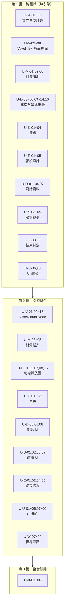

# 最小單元清單

> 把所有計劃要實作的部分拆解為**最小可獨立驗證單元**（Atomic Unit）。
> 每個單元 = 一個可獨立測試的實作單位，有明確的輸入、輸出、驗證方式。

---

## 為什麼要拆到最小單元

| 問題 | 拆解後的好處 |
|---|---|
| 「建造系統做好了嗎？」無法回答 | 可以回答「U-B-07 面剔除通過、U-B-12 多材質群組未做」 |
| 一個 bug 要翻整個系統 | 單元測試直接指出哪個單元壞了 |
| 改 A 壞 B 不知道 | 每個單元有獨立測試，回歸立刻發現 |
| 進度無法量化 | 單元數 = 進度分母 |

---

## 單元編號規則

```
U-<模組>-<序號>

模組代碼：
  W   世界生成（World）
  V   Voxel 渲染（Voxel）
  M   材質（Material）
  B   建造操作（Build）
  C   角色（Character）
  K   按鍵（KeyBindings）
  D   對話（Dialogue）
  S   過場（Sequence）
  E   結束（Ending）
  U   UI
  P   預設設計庫（Preset）
  X   跨模組整合（Integration）
```

**單元大小判準**（必須同時滿足）：

1. 可以寫出**至少一個**自動化斷言（第 1 或第 2 層）
2. 不需要等其他單元完成就能驗證
3. 改動它不會連帶影響超過 2 個其他單元
4. 預估實作時間 ≤ 半天

---

## 圖例

| 符號 | 意義 |
|---|---|
| ✅ | 已實作並通過 |
| 🔶 | 已規劃，尚未實作 |
| ⏸️ | Demo 後才做 |
| ⬜ | 純視覺／手感，只能第 3 層人工驗證 |

---

## 統計總覽

| 模組 | 單元數 | 已實作 | 待實作 | Demo 後 | 純人工 |
|---|---|---|---|---|---|
| W 世界生成 | 9 | 0 | 9 | 0 | 0 |
| V Voxel 渲染 | 14 | 0 | 14 | 0 | 0 |
| M 材質 | 7 | 0 | 7 | 0 | 0 |
| B 建造操作 | 16 | 0 | 16 | 0 | 0 |
| C 角色 | 13 | 6 | 7 | 2 | 0 |
| K 按鍵 | 4 | 4 | 0 | 0 | 0 |
| D 對話 | 8 | 0 | 8 | 0 | 0 |
| S 過場 | 7 | 0 | 7 | 0 | 0 |
| E 結束 | 6 | 0 | 6 | 2 | 0 |
| U UI | 10 | 0 | 10 | 0 | 0 |
| P 預設設計庫 | 5 | 0 | 5 | 0 | 0 |
| X 整合 | 6 | 0 | 6 | 0 | 0 |
| **合計** | **105** | **10** | **95** | **4** | **0** |

---

## W — 世界生成（9 個單元）

對應 [[P6 世界生成]]、[[N0 世界生成中]]

| ID | 單元 | 輸入 | 輸出 | 驗證層 | 狀態 |
|---|---|---|---|---|---|
| U-W-01 | `WorldGenConfig` 型別與預設值 | — | 常數物件 | 1 | 🔶 |
| U-W-02 | 可編輯區塊範圍計算 | `editableRadius` | `{minX,maxX,minZ,maxZ}` | 1 | 🔶 |
| U-W-03 | 周圍一圈範圍計算（挖空中心） | `solidRadius`, `editableRadius` | 環狀座標集合 | 1 | 🔶 |
| U-W-04 | 延伸區範圍計算 | `playableRadius` | 外環座標集合 | 1 | 🔶 |
| U-W-05 | 平坦地形填充（可編輯區塊） | config | `Uint16Array` 內容 | 1 | 🔶 |
| U-W-06 | 深層方塊填充（Y = -10 ~ 0） | config | 方塊 id 分佈 | 1 | 🔶 |
| U-W-07 | 延伸區單層平面生成 | config | `MeshNode` 幾何 | 2 | 🔶 |
| U-W-08 | 世界邊界牆生成（4 面） | `playableRadius` | 4 個 `MeshNode` | 2 | 🔶 |
| U-W-09 | 霧設定套用 | `fogNear`, `fogFar` | `FogNode` 屬性 | 2 | 🔶 |

**U-W-01 驗證**：`assertEqual(config.surfaceY, 0)`、`assertEqual(config.depth, 10)`

**U-W-02 驗證**：`editableRadius = 8` → `{minX: -8, maxX: 7, minZ: -8, maxZ: 7}`（16×16）

**U-W-03 驗證**：`solidRadius = 24`、`editableRadius = 8` → 環狀集合大小 = `48² − 16² = 2048`

**U-W-05 驗證**：`getVoxel(0, 0, 0) !== 0`（地表有方塊）、`getVoxel(0, 1, 0) === 0`（地表上方是空氣）

**U-W-06 驗證**：`getVoxel(0, -10, 0) !== 0`（最深處有方塊）、`getVoxel(0, -11, 0)` 越界

---

## V — Voxel 渲染（14 個單元）

對應 [[P2 建造系統]] §1

| ID | 單元 | 輸入 | 輸出 | 驗證層 | 狀態 |
|---|---|---|---|---|---|
| U-V-01 | `VoxelChunkNode` 類別骨架 | — | 可 `create()` | 2 | 🔶 |
| U-V-02 | 尺寸常數（16×266×16） | — | `sizeX/Y/Z` | 1 | 🔶 |
| U-V-03 | 索引計算 `index(x,y,z)` | 座標 | `number` | 1 | 🔶 |
| U-V-04 | 邊界檢查 `inBounds()` | 座標 | `boolean` | 1 | 🔶 |
| U-V-05 | `setVoxelRaw()` 只改資料 | 座標 + id | `boolean` | 1 | 🔶 |
| U-V-06 | `markDirty()` 標記重建 | — | `dirty = true` | 1 | 🔶 |
| U-V-07 | 面剔除（鄰居有空氣才生成） | 3×3×3 資料 | 面數 | 1 | ✅ `faceCulling.unit.ts` |
| U-V-08 | 六方向法向量與頂點順序 | `FaceDir` | 4 角座標 | 1 | ✅ `faceCulling.unit.ts` |
| U-V-09 | 幾何建構（頂點／索引／UV） | 面清單 | `BufferGeometry` | 2 | 🔶 |
| U-V-10 | 多材質群組 `addGroup()` | 材質槽 bucket | `groups[]` | 2 | 🔶 |
| U-V-11 | 材質槽映射 `slotMap` | `blockId:faceDir` | `slot` | 1 | 🔶 |
| U-V-12 | `rebuildMesh()` 重建流程 | dirty 資料 | 新 geometry | 2 | 🔶 |
| U-V-13 | 重建節流（`setTickInterval(0.05)`） | 連續 dirty | 20 次/秒 | 2 | 🔶 |
| U-V-14 | `getPlacedBlockCount()` | — | 非空氣方塊數 | 1 | 🔶 |

**U-V-07 已實作**：`tests/voxel/faceCulling.unit.ts`（8 組測試）

**U-V-09 驗證**：單一方塊 → 36 頂點（6 面 × 6 頂點）、24 個 UV 座標

**U-V-10 驗證**：2 種材質 → `geometry.groups.length === 2`、`groups[0].materialIndex === 0`

**U-V-13 驗證**：0.5 秒內 `rebuildMesh` 被呼叫約 10 次（不是 30 次）

---

## M — 材質（7 個單元）

對應 [[P2 建造系統]] §2

| ID | 單元 | 輸入 | 輸出 | 驗證層 | 狀態 |
|---|---|---|---|---|---|
| U-M-01 | 方塊 id 常數表 | — | `BLOCK_STONE` 等 | 1 | 🔶 |
| U-M-02 | 方塊 → 六面材質映射表 | `blockId` | `[top, bottom, side...]` | 1 | 🔶 |
| U-M-03 | `makePlaceholderTexture()` | 顏色 + 尺寸 | `CanvasTexture` | 2 | 🔶 |
| U-M-04 | 佔位貼圖 `NearestFilter` 設定 | — | `magFilter/minFilter` | 2 | 🔶 |
| U-M-05 | 材質載入（`@project/assets/...`） | 路徑 | `THREE.Material` | 2 | 🔶 |
| U-M-06 | 材質槽去重（9 種方塊 → 13 槽） | 映射表 | `slotMap.size` | 1 | 🔶 |
| U-M-07 | 透明方塊旗標 `isTransparent` | `blockId` | `boolean` | 1 | ⏸️ |

**U-M-06 驗證**：9 種方塊（grass 有 top/side 兩種）→ 去重後 13 個材質槽

**U-M-07**：Demo 後才實作，但**架構預留旗標**

---

## B — 建造操作（16 個單元）

對應 [[P2 建造系統]] §4–§10、[[N8 確認放置]]、[[N9 Submit 區塊]]

| ID | 單元 | 輸入 | 輸出 | 驗證層 | 狀態 |
|---|---|---|---|---|---|
| U-B-01 | 射線選格（第一人稱準心） | 相機 + 5 格 | 命中格座標 | 2 | ✅ `raycast.engine.ts` |
| U-B-02 | 射線選格（上帝視角滑鼠） | 相機 + 滑鼠 | 命中格座標 | 2 | 🔶 |
| U-B-03 | 放置位置計算（命中點 + 法向量） | 命中結果 | 相鄰格 | 1 | ✅ `raycast.engine.ts` |
| U-B-04 | 破壞位置計算（命中點 − 法向量） | 命中結果 | 目標格 | 1 | ✅ `raycast.engine.ts` |
| U-B-05 | 可建造範圍檢查 | 座標 | `boolean` | 1 | 🔶 |
| U-B-06 | 放置失敗原因分類 | 座標 | `'outOfBounds'` | 1 | 🔶 |
| U-B-07 | 單格放置（含 `placeMode`） | 座標 + id + `placeMode` | 資料變更 | 2 | 🔶 |
| U-B-08 | 單格破壞 | 座標 | 資料變更 | 2 | 🔶 |
| U-B-09 | 連續模式（拖曳） | 起點 + 終點 | 格清單 | 1 | 🔶 |
| U-B-10 | 矩形模式 | 對角兩點 | 格清單 | 1 | 🔶 |
| U-B-11 | 柱狀模式 | 底面 + 高度 | 格清單 | 1 | 🔶 |
| U-B-12 | `UndoRedoStack.push()` | `VoxelEdit[]` | 堆疊狀態 | 1 | 🔶 |
| U-B-13 | `UndoRedoStack.undo()` | — | `VoxelEdit[]` | 1 | 🔶 |
| U-B-14 | `UndoRedoStack.redo()` | — | `VoxelEdit[]` | 1 | 🔶 |
| U-B-15 | 批次模式拖曳中不重建 | 拖曳事件 | `rebuildMesh` 未呼叫 | 2 | 🔶 |
| U-B-16 | Submit 判定（方塊數 = 0） | `getPlacedBlockCount()` | `'blank' \| 'normal'` | 1 | 🔶 |

**U-B-09 驗證**：`(0,0,0)` → `(3,0,0)` → 4 格（含端點）

**U-B-10 驗證**：`(0,0,0)` 到 `(2,2,0)` → 9 格（3×3）

**U-B-11 驗證**：底面 `(0,0,0)`、高度 5 → 5 格（Y 軸）

**U-B-12~14 驗證**：push 3 次 → undo 3 次回到初始 → redo 3 次回到最終

---

## C — 角色（13 個單元）

對應 [[P4 角色系統]]、[[N4 玩家可自由行動]]

| ID | 單元 | 輸入 | 輸出 | 驗證層 | 狀態 |
|---|---|---|---|---|---|
| U-C-01 | `MyCharacterPawn` 類別骨架 | — | 可 `create()` | 2 | ✅ `playerStack.engine.ts` |
| U-C-02 | 第一人稱相機位置（pivot = camera） | — | 相同座標 | 2 | ✅ `playerStack.engine.ts` |
| U-C-03 | 眼高 `y = 0.7` | — | `cameraPivot.position.y` | 1 | 🔶 |
| U-C-04 | 視覺模型偏移 `y = -0.9` | — | `visualNode.position.y` | 2 | ✅ `playerStack.engine.ts` |
| U-C-05 | `setHiddenInGame(true)` 隱藏本體 | `true` | `hiddenInGame = true` | 2 | 🔶 |
| U-C-06 | `setHiddenInGame(false)` 顯示本體 | `false` | `hiddenInGame = false` | 2 | 🔶 |
| U-C-07 | 編輯器不受隱藏影響 | `isEditorWorld` | `layers` 不變 | 2 | 🔶 |
| U-C-08 | `FlyingMovementNode` 飛行切換 | `toggleFly()` | `isFlying` 翻轉 | 2 | ✅ `playerStack.engine.ts` |
| U-C-09 | 飛行時無重力 | `isFlying = true` | `verticalVelocity` 可控 | 2 | ✅ `playerStack.engine.ts` |
| U-C-10 | 落地自動取消飛行 | 碰撞地面 | `isFlying = false` | 2 | 🔶 |
| U-C-11 | `MyPlayerController` 動作委派 | 按鍵 | `GameplayAction` | 2 | ✅ `playerStack.engine.ts` |
| U-C-12 | 雙擊空白鍵偵測（300ms 視窗） | 兩次 keydown | `toggleFly` 動作 | 1 | 🔶 |
| U-C-13 | 織界者 NPC 平移（`NpcMovementNode`） | 目標座標 | 位置變化 + 自動轉向 | 2 | 🔶 |

**U-C-03 驗證**：`assertEqual(pivot.position.y, 0.7)`（1.8 × 0.39 ≈ 0.702，取 0.7）

**U-C-05/06 驗證**：headless 測試斷言 `hiddenInGame` 旗標（`isEditorWorld` 時 `layers` 不變）

**U-C-12 驗證**：`t=0` keydown、`t=200ms` keydown → 觸發；`t=400ms` → 不觸發

**U-C-13 驗證**：`setTargetPosition((10, 0, 0))` → 推進 N 個 tick 後 `getWorldPosition().x` 接近 10（誤差 < `stopDistance`）；同時 `getWorldRotation().y` 已轉向目標方向

---

## K — 按鍵（4 個單元）

對應 [[P2 建造系統]] §9

| ID | 單元 | 輸入 | 輸出 | 驗證層 | 狀態 |
|---|---|---|---|---|---|
| U-K-01 | `DEFAULT_KEY_BINDINGS` 常數表 | — | 10 個動作 | 1 | ✅ `keyBindings.unit.ts` |
| U-K-02 | `matchesBinding()` 修飾鍵判斷 | `KeyboardEvent` | `boolean` | 1 | ✅ `keyBindings.unit.ts` |
| U-K-03 | `rebind()` 自訂按鍵 | 動作 + 新鍵 | 更新表 | 1 | ✅ `keyBindings.unit.ts` |
| U-K-04 | `resetKeyBindings()` 還原預設 | — | 預設表 | 1 | ✅ `keyBindings.unit.ts` |

**已全部實作**：`tests/input/keyBindings.unit.ts`（18 個測試）

---

## D — 對話（8 個單元）

對應 [[P5 對話系統]]、[[N2 環境描述對話]]、[[N3 織界者現身]]、[[N10 織界者對話]]

| ID | 單元 | 輸入 | 輸出 | 驗證層 | 狀態 |
|---|---|---|---|---|---|
| U-D-01 | `DialogueLine` 型別 | — | 介面 | 1 | 🔶 |
| U-D-02 | 對話序列資料（`INTRO_DIALOGUE`） | — | `DialogueLine[]` | 1 | 🔶 |
| U-D-03 | 序列推進（下一句） | 索引 | 下一索引 | 1 | 🔶 |
| U-D-04 | 序列結束判定 | 索引 | `boolean` | 1 | 🔶 |
| U-D-05 | 打字機效果（逐字顯示） | 文字 + 速度 | `textContent` 漸增 | 2 | 🔶 |
| U-D-06 | 打字機跳過（立即全顯） | — | 完整文字 | 2 | 🔶 |
| U-D-07 | speaker 名稱與顏色對應 | `speaker` | CSS class | 1 | 🔶 |
| U-D-08 | 對話框 UI 掛載位置 | — | `world.gameContainer` 內 | 2 | 🔶 |

**U-D-03 驗證**：`next(0) === 1`、`next(最後) === null`

**U-D-07 驗證**：`'玩家'` → `player` class、`'???'` → `unknown` class、`''` → 無 class

**U-D-08 驗證**：`world.gameContainer.contains(dialogueBox.element) === true`

---

## S — 過場（7 個單元）

對應 [[P1 過場系統]]、[[N0 世界生成中]]、[[N1 眼睛睜開濾鏡]]、[[N3 織界者現身]]

| ID | 單元 | 輸入 | 輸出 | 驗證層 | 狀態 |
|---|---|---|---|---|---|
| U-S-01 | 黑幕 overlay 建立與掛載 | — | `div` 在 `gameContainer` | 2 | 🔶 |
| U-S-02 | 黑幕淡出（opacity 1 → 0） | 時長 | `opacity` 變化 | 2 | 🔶 |
| U-S-03 | 眼形遮罩（`clip-path`） | 進度 0–1 | `clip-path` 字串 | 1 | 🔶 |
| U-S-04 | 眨眼序列（快速開合兩次） | — | 關鍵影格序列 | 1 | 🔶 |
| U-S-05 | 模糊濾鏡淡出（`backdrop-filter`） | 進度 0–1 | `blur(Npx)` | 1 | 🔶 |
| U-S-06 | 玩家轉頭（`cameraPivot` yaw 補間） | 目標 yaw | 旋轉變化 | 2 | 🔶 |
| U-S-07 | 過場期間鎖定輸入 | — | `setInputEnabled(false)` | 2 | 🔶 |

**U-S-03 驗證**：`progress=0` → `ellipse(50% 0% ...)`、`progress=1` → `ellipse(50% 50% ...)`

**U-S-04 驗證**：序列長度 = 5（閉→開→閉→開→保持）

**U-S-06 驗證**：tween 結束後 `pivot.rotation.y ≈ targetYaw`（誤差 < 0.01）

---

## E — 結束（6 個單元）

對應 [[P3 結束系統]]、[[N10 織界者對話]]、[[N12 遊戲結束]]

| ID | 單元 | 輸入 | 輸出 | 驗證層 | 狀態 |
|---|---|---|---|---|---|
| U-E-01 | 玩家轉向織界者（yaw 補間） | 織界者座標 | `pivot.rotation.y` | 2 | 🔶 |
| U-E-02 | 織界者轉向玩家（yaw 補間） | 玩家座標 | `rotation.y` | 2 | 🔶 |
| U-E-03 | 白卷彩蛋台詞選擇 | `blockCount` | 台詞陣列 | 1 | 🔶 |
| U-E-04 | 白卷生成動畫（方塊逐格出現） | 設計資料 | 分批 `setVoxelRaw` | 2 | 🔶 |
| U-E-05 | 結束畫面顯示（標題 + credits） | — | `CenterMessage` | 2 | 🔶 |
| U-E-06 | 統計資料（方塊數／時間） | — | 文字 | 1 | ⏸️ |

**U-E-03 驗證**：`blockCount = 0` → 彩蛋台詞；`blockCount > 0` → 正常台詞

**U-E-04 驗證**：3 秒後 `getPlacedBlockCount()` 從 0 增加到設計方塊數

---

## U — UI（10 個單元）

對應 [[P7 UI 系統]]、[[N6 選類別]]、[[N9 Submit 區塊]]

| ID | 單元 | 輸入 | 輸出 | 驗證層 | 狀態 |
|---|---|---|---|---|---|
| U-U-01 | 快捷欄建立（`InventoryBar`） | 9 個項目 | UI 元件 | 2 | 🔶 |
| U-U-02 | 快捷欄點擊選取 | 點擊索引 | `selectedBlockId` | 2 | 🔶 |
| U-U-03 | 準心顯示／隱藏（Minecraft 反色十字） | 視角模式 | `show()` / `hide()` | 2 | 🔶 |
| U-U-04 | Submit 按鈕建立與點擊（`Ctrl+Enter`） | — | 觸發 `onSubmit()` | 2 | 🔶 |
| U-U-05 | 類別分頁生成（`Card` + `mountChild(Button)`） | `PRESET_CATEGORIES` | 分頁按鈕 | 2 | 🔶 |
| U-U-06 | 「全部」分頁 | — | 合併所有設計 | 1 | 🔶 |
| U-U-07 | 放置失敗提示（`CenterMessage`） | 失敗原因 | 文字訊息 | 2 | 🔶 |
| U-U-08 | 選取框（`EdgesGeometry`） | 目標格 | 線框位置 | 2 | 🔶 |
| U-U-09 | 放置預覽（實際材質，透明度 0.5，只在上帝視角） | 目標格 | 半透明方塊 | 2 | 🔶 |
| U-U-10 | 超出範圍選取框變紅 | 座標 | 材質顏色 | 1 | 🔶 |

**U-U-02 驗證**：點擊第 3 格 → `selectedBlockId === items[2].id`，且該格有 `selected` class、其他格沒有

**U-U-03 驗證**：`crosshair.getElement()` 的 `.ui-crosshair` 有 `mix-blend-mode: difference`；切換到上帝視角 → `getIsVisible() === false`

**U-U-04 驗證**：`Ctrl+Enter` keydown → `onSubmit()` 被呼叫；單獨 `Enter` → 不觸發

**U-U-05 驗證**：`PRESET_CATEGORIES` 有 4 個類別 → 生成 5 個分頁按鈕（含「全部」）；點擊第 2 個 → 該按鈕 `variant === 'primary'`，其他為 `'ghost'`

**U-U-06 驗證**：3 個類別各有 2 個設計 → 「全部」分頁顯示 6 個

**U-U-09 驗證**：上帝視角 → 預覽方塊存在且 `material.opacity === 0.5`、`material.transparent === true`、`material.depthWrite === false`；第一人稱 → 預覽方塊不存在

**U-U-10 驗證**：`inBounds = false` → `material.color.getHex() === 0xff0000`

---

## P — 預設設計庫（5 個單元）

對應 [[P2 建造系統]] §11、[[N6 選類別]]、[[N7 選設計]]

| ID | 單元 | 輸入 | 輸出 | 驗證層 | 狀態 |
|---|---|---|---|---|---|
| U-P-01 | `PresetDesign` / `PresetCategory` 型別 | — | 介面 | 1 | 🔶 |
| U-P-02 | `PRESET_CATEGORIES` 資料 | — | 陣列 | 1 | 🔶 |
| U-P-03 | `applyPreset()` 寫入方塊（含 `placeMode`） | 設計 + 原點 + `placeMode` | 資料變更 | 1 | 🔶 |
| U-P-04 | 預設整體平移 | 位移向量 | 所有方塊偏移 | 1 | 🔶 |
| U-P-05 | 預設整體旋轉（90° 倍數） | 角度 | 座標重算 | 1 | 🔶 |

**U-B-06 驗證**：`(100, 0, 0)` → `'outOfBounds'`；`(0, 0, 0)` → `null`（成功）

**U-B-07 驗證**：`placeMode = 'replace'` 時目標格已有方塊 → 覆蓋；`placeMode = 'skip'` 時 → 保持原值不變

**U-P-03 驗證**：設計含 3 個方塊 → `getPlacedBlockCount()` 增加 3（`placeMode = 'replace'`）；若 2 格已被佔用且 `placeMode = 'skip'` → 只增加 1

**U-P-05 驗證**：`(1,0,0)` 順時針旋轉 90° → `(0,0,-1)`；`(0,0,-1)` → `(-1,0,0)`；`(x,z) → (-z, x)`

---

## X — 跨模組整合（6 個單元）

這些單元驗證「多個模組一起運作」，屬於第 2 層或第 3 層。

| ID | 單元 | 涉及模組 | 驗證層 | 狀態 |
|---|---|---|---|---|
| U-X-01 | 世界生成 → 玩家出生在 `Player Start` | W + C | 2 | 🔶 |
| U-X-02 | 建造模式切換（第一人稱 ↔ 上帝視角） | B + C + U | 2 | 🔶 |
| U-X-03 | 放置方塊 → 網格重建 → 可見 | B + V | 2 | 🔶 |
| U-X-04 | 過場序列完整流程（N0 → N3） | S + D | 3 | 🔶 |
| U-X-05 | Submit → 結束流程（N9 → N12） | B + E + D | 3 | 🔶 |
| U-X-06 | 白卷彩蛋完整流程 | B + E + D + V | 3 | 🔶 |

**U-X-01 驗證**：`pawn.getWorldPosition()` 等於 `PlayerStart` 座標（± 2 單位偏移）

**U-X-02 驗證**：切換後 `world.getActiveCamera()` 改變、`hiddenInGame` 同步

**U-X-03 驗證**：`placeBlock()` 後 `advanceTicks(0.1)` → `mesh.geometry.attributes.position.count` 增加

---

## 實作順序（依賴關係）



### 建議實作批次

| 批次 | 單元 | 說明 |
|---|---|---|
| **1** | U-W-01~06、U-V-02~08、U-M-01/02/06、U-B-03~06/09~14/16、U-P-01~05 | 純函式，可一次寫完並全綠 |
| **2** | U-V-01/09~13、U-M-03~05、U-W-07~09 | `VoxelChunkNode` + 材質 + 世界節點 |
| **3** | U-B-01/02/07/08/15、U-U-08~10 | 射線選格 + 放置 + 選取框 |
| **4** | U-C-03/05~07/10/12/13 | 角色修正（眼高、隱藏、飛行落地） |
| **5** | U-U-01~07、U-D-01~08 | UI 元件 + 對話 |
| **6** | U-S-01~07、U-E-01~05 | 過場 + 結束 |
| **7** | U-X-01~06 | 整合驗證 |

---

## 與現有測試的對應

| 現有測試檔 | 覆蓋單元 | 測試數 |
|---|---|---|
| `tests/voxel/faceCulling.unit.ts` | U-V-07, U-V-08 | 15 |
| `tests/voxel/greedyMesh.unit.ts` | （參考實作，非單元） | 12 |
| `tests/voxel/coords.unit.ts` | U-V-03, U-V-04（部分） | 21 |
| `tests/voxel/VoxelMeshNode.engine.ts` | （引擎基準，非單元） | 6 |
| `tests/world/smoke.engine.ts` | （可行性驗證） | 5 |
| `tests/world/World.engine.ts` | U-V-13（節流機制） | 9 |
| `tests/build/raycast.engine.ts` | U-B-01, U-B-03, U-B-04 | 8 |
| `tests/character/playerStack.engine.ts` | U-C-01, U-C-02, U-C-04, U-C-08, U-C-09, U-C-11 | 21 |
| `tests/input/keyBindings.unit.ts` | U-K-01~04 | 18 |
| **合計** | **10 個單元已覆蓋** | **115** |

---

## 已定案（2026-11-01）

| 項目 | 決定 | 影響單元 |
|---|---|---|
| **U-P-05 旋轉方向** | **順時針**（俯視 +Y 往下看）。公式 $(x, z) \rightarrow (-z, x)$。驗證：`(1,0,0)` → `(0,0,-1)` | U-P-05 |
| **U-B-06 放置失敗** | **只有 `'outOfBounds'`**。沒有「已被佔用」的失敗狀態 | U-B-06 |
| **放置覆蓋行為** | 新增 `PlaceMode = 'replace' \| 'skip'`。`'replace'` 直接覆蓋（預設）；`'skip'` 目標格已有方塊就跳過，不報錯 | U-B-07、U-P-03 |
| **U-C-13 織界者平移** | **`NpcMovementNode.setTargetPosition()`** —— 和一般角色移動一樣，只是沒有移動動畫。自動轉向、有 `stopDistance`、走物理不穿牆 | U-C-13 |
| **U-U-05 類別分頁** | **`Card` + `mountChild(Button)`** —— 只用公開 API，不依賴內部 class 名。網格 CSS 自己寫 ~15 行 | U-U-05、U-U-06 |
| **U-U-03 準心** | **Minecraft 反色十字** —— 繼承 `Crosshair`，覆寫 `getAssetPaths()` 換自訂 CSS（`mix-blend-mode: difference`）+ 覆寫 `onInitialize()` 畫十字 SVG | U-U-03 |
| **U-U-02 快捷欄選中** | `InventoryBar` 無「選中」概念，自己加 `selected` class。先做功能，樣式 Demo 後調 | U-U-02 |
| **U-U-09 放置預覽** | **只在上帝視角**、**實際材質**、**透明度 0.5**、`depthWrite = false` | U-U-09 |
| **U-U-04 Submit 快捷鍵** | **`Ctrl+Enter`**（原本 `Enter` 太容易誤按）。`Alt+Enter` 可作備用 | U-U-04、U-K-01 |
| **U-U-05 分頁版面** | 分頁在**頂部**，網格**每行 5 個** | U-U-05 |

### 為什麼 U-C-13 選 `NpcMovementNode`

引擎有兩套移動系統：

| | 舊系統（Legacy） | 新系統（Mover） |
|---|---|---|
| Pawn | `CharacterPawn` / `MovementPawn` | `MoverCharacterPawn` |
| 移動節點 | `CharacterMovementNode` / `NpcMovementNode` | `MoverNode` + `WalkingMode` |
| 控制器 | `DefaultPlayerController` | `MoverPlayerController` / `AIController` |

本專案用**舊系統**（`MyCharacterPawn extends DefaultCharacterPawn extends CharacterPawn`），所以織界者用 `NpcMovementNode`：

```typescript
npcMovementNode.setTargetPosition(new THREE.Vector3(x, y, z), stopDistance);
```

- `moveTowardPoint()` 自動 `addLookRightInput(-yawDiff)` 轉向
- `applyMovementInput()` 自動 `addForwardInput(1.0)` 前進
- `canUseNavigationServer()` 回 `false` 時走 `setPath([target], false)` 直線，**不需要 navmesh**
- 沒有動畫狀態機 → 天然「沒有移動動畫」

**注意**：`NpcMovementNode` 是 `CharacterMovementNode` 的子類，需掛在 `MovementPawn` 上。織界者若目前是純 `ModelMeshNode`，需改成 `MovementPawn` 或 `CharacterPawn`。

### 為什麼 U-U-05 選 `Card` + `mountChild(Button)`

`InventoryGrid`（14.8 KB）的模板是固定的：

```html
<div class="ui-inventory-grid">
  <div class="ui-inventory-grid-header">
    <h3 class="ui-inventory-grid-title">Inventory</h3>   ← 寫死
    <button class="ui-inventory-grid-close">&times;</button>
  </div>
  <div class="ui-inventory-grid-content" style="grid-template-columns: repeat({{columns}}, ...)">
    <div data-inventory-grid-slots></div>   ← 只有插槽容器
  </div>
</div>
```

**沒有分頁標籤的位置**，且 `columns`/`rows` 固定。

**3 條路徑比較**：

| 路徑 | 自訂碼量 | 自訂 CSS | 依賴內部實作 | 浪費現有功能 |
|---|---|---|---|---|
| A. `InventoryGrid` + 插 DOM | ~40 行 | 只有分頁列 | 🔴 依賴 `.ui-inventory-grid-header` | ❌ 拖放用不到 |
| **B. `Card` + `mountChild(Button)`** | **~30 行** | **網格 ~15 行** | **🟢 無** | **🟢 用到 `Card` + `Button` + `mountChild`** |
| C. 完全自訂 | ~120 行 | 全部 | 🟢 無 | 🔴 浪費 `Card`、`Button`、`mountChild` |

**選 B 的理由**：

1. **`Button` 的 `ghost` variant 已接近 flat design**（透明背景 + hover 變色）
2. **`mountChild()` 是引擎提供的組合機制**（`BaseUIComponent.ts:335`），自動處理 `position: 'none'`、`initialize()`、DOM 搬移、`destroy()` 追蹤
3. **不依賴任何內部 class 名**，引擎改版不會壞
4. **唯一要自己寫的是網格 CSS**（~15 行）

**架構**：

```typescript
const card = new ENGINE.Card(world.uiManager, { title: '設計庫', position: 'center' });
await card.initialize();

const body = card.getElement()?.querySelector('[data-card-body]');

const tabsRow = document.createElement('div');
tabsRow.className = 'preset-tabs';
body?.appendChild(tabsRow);

const grid = document.createElement('div');
grid.className = 'preset-grid';
body?.appendChild(grid);

for (const cat of [{ id: 'all', name: '全部' }, ...PRESET_CATEGORIES]) {
  await card.mountChild(ENGINE.Button, {
    label: cat.name,
    variant: 'ghost',
    size: 'small',
    onClick: () => switchCategory(cat.id),
  }, tabsRow);
}
```

**CSS**：

```css
.preset-tabs {
  display: flex;
  gap: 4px;
  margin-bottom: 12px;
  border-bottom: 1px solid rgba(255, 255, 255, 0.1);
}
.preset-grid {
  display: grid;
  grid-template-columns: repeat(5, 64px);
  gap: 8px;
}
```

---

## 相關

- [[README|測試架構]]
- [[第1層 純邏輯測試]]
- [[第2層 引擎整合測試]]
- [[第3層 執行期驗證]]
- [[覆蓋率對照]]
