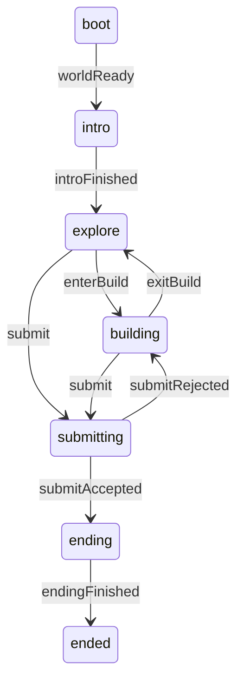

# The Loomkeeper — A Minecraft What-If

**CIS428 Metaverse Technology — Assignment 2**

---

## 1. Concept

The Loomkeeper is a short first-person building experience set inside a Minecraft
world that has not finished generating. The player arrives one chunk early and
finds the entity responsible for terrain generation — an overworked, unglamorous
colleague who has been weaving worlds alone for longer than he can remember — and
is asked to finish the last chunk for him.

The what-if is deliberately narrow: Minecraft never explains *who* decides what
gets generated. The Loomkeeper is that silence given a voice. He is not a god and
does not behave like one; he hands over the job and goes back to work. Nothing in
the experience contradicts the official setting, which is what makes it an
expansion rather than a recolour.

---

## 2. Why The Sandbox Studio instead of GameMaker

The first prototype was built in The Sandbox **GameMaker**. It was abandoned for
one reason: GameMaker cannot place an individual voxel. Its building vocabulary is
a set of pre-authored objects that can be swapped and moved, so the closest we
could get to Minecraft was a row of fixed statues to choose between. The core
verb of Minecraft — *put a block here* — was not expressible.

The Sandbox **Studio** ships a scripting layer (Genesys.js) on top of the same
asset pipeline. That makes the voxel grid something the game owns rather than
something the engine owns.

| Capability | GameMaker | Studio (shipped) |
|---|---|---|
| Place a single voxel | Not possible | `VoxelChunkNode.setVoxel()` |
| Break a voxel | Not possible | Same API, undoable |
| Custom mesh per chunk | No | Own `BufferGeometry` builder |
| Undo / redo | No | Own stack, one entry per edit batch |
| First-person camera control | Limited | Full camera pivot control |
| Per-frame game logic | Rules-based | `tickPrePhysics` on any node |

The cost is visible in section 3: none of the voxel layer existed, so the chunk
mesh builder, the face-culling rules, the bounds checker and the undo stack are
all written from scratch. That trade — total control for total responsibility —
is the single biggest decision in the project.

---

## 3. Technical Architecture

### 3.1 Voxel chunk rendering

The world is 25 chunks of 16×16 columns, spanning y = 0 to 255. Handing 4,096
individual block meshes to the renderer would cost thousands of draw calls, so the
engine's mesh nodes are not used for terrain at all.

`VoxelChunkNode` owns a `Uint16Array` of block ids and rebuilds one
`BufferGeometry` when the chunk is marked dirty. Three things make that affordable:

**Face culling.** A face is emitted only when the neighbouring voxel is air. A
16×16×256 chunk of solid stone emits its shell and nothing else. The neighbour
lookup goes through a `NeighborSampler`, which is what removes the shared plane
between two chunks — without it every chunk draws its whole outer shell and two
neighbours draw the same plane twice.

**Material groups.** Indices are bucketed per material slot before the geometry is
written, so each group is contiguous and the chunk costs one draw call per block
type present rather than one per block. Slots with no faces still get an entry, so
the array index always equals the material slot index; otherwise three.js binds
the wrong texture.

**Dirty batching.** Edits inside one gesture are collected and rebuilt once. Undo
and redo reuse the same path, so a 200-block undo is one rebuild, not 200.

### 3.2 World layout

Three concentric regions, measured in chunks because the chunk grid is the unit
the generator works in:

| Region | Radius | Extent | Height | Purpose |
|---|---|---|---|---|
| `editable` | 0 | 1 chunk (16×16) | Full, y 0–255 | Where the player builds |
| `solid` | 1 | Ring around it (48×48 total) | Full | No void is visible from inside |
| `playable` | 2 | Outer ring (80×80 total) | One surface layer | The horizon does not end abruptly |

The surface sits at `surfaceY = 10` rather than 0 so there are ten layers of
sub-surface blocks to dig through; a surface at 0 would be a single-layer floor
over void. In the game the centre chunk is additionally carved down to
`minY = 0` to make the pit the player builds inside, so the bedrock floor *is* the
bottom of the world — there is no air pocket under it to fall through.

All of these numbers are read from `WorldGenConfig`. The gameplay variant is a
spread of the default plus `carveCenterDepth`, so world generation keeps its own
tests (which assume flat ground) while the game gets its pit.

### 3.3 First-person rendering

A camera placed inside a character's head sees the inside of the head. Minecraft
solves this in four steps and so does this project.

| Step | Minecraft | Here |
|---|---|---|
| 1. Eye height | Camera at eye level | `eyeHeight = 1.62` m above the feet |
| 2. Hide own body | Own model not drawn in first person | `setHiddenInGame(true)` on the visual node |
| 3. Separate arm | Arm is its own model | `FirstPersonArm` parented to the camera pivot |
| 4. Near plane | Small near clip so walls do not clip | `CAMERA_NEAR = 0.1` (engine default) |

The arm is a box parented to the camera pivot, and it is drawn with the
**ordinary depth test and depth write enabled**. That is the counter-intuitive
part. The usual trick for view models is to disable the depth test and push a high
`renderOrder`, and it does not work here: the voxel terrain is rendered by a
separate pass that ignores `renderOrder` and painted straight over the arm.
Turning depth *write* off is worse — the terrain's own depth test then sees no arm
at all and covers it anyway. What works is the physical fact that the arm sits
0.30–0.42 m from the camera while the player's collider half-width is 0.3 m, so it
is nearer than any wall the player can stand against.

The arm swings on both mouse buttons — including a swing on a miss, which is the
only feedback that a click was received while not in build mode. The rotation
pivot is the **elbow**, not the wrist and not the box centre: the elbow stays in
the bottom-right corner of the frame and the hand is the free end. The swing is
driven by two curves, `sin(√p·π)` for the punch and `sin(p·π)` for the sideways
flick, over a fixed 0.3 s.

### 3.4 The two character models

**The Loomkeeper** is the VoxEdit export, `assets/models/Loomkeeper.glb`, loaded
unchanged through `ModelMeshNode`. That file is the complete rig — 45 meshes across 106
nodes, from `HeadCore` and `Neck` down through `ShoulderSocket`, `Humerus`, `UpperArm`,
`ForeArm` and `Hand` on both sides, plus three-segment legs — and its textures carry the
palette: stone grey, sandstone, the wood-brown shoulder blocks and the blue core.


An earlier version rebuilt the character from a reference document instead. That
document listed only the torso parts, so the result had no arms and no head, which is
exactly the failure mode of transcribing a rig from a summary. The lesson is in what
replaced it: load the export, and measure it rather than retyping it.

Measurement is also what drives the collider. Walking the node tree and transforming
every `POSITION` bound by its world matrix gives an assembled span of 64.2 × 130.047 ×
16.2 units — nothing like the 23 × 37 × 16 that the *mesh-local* accessors report,
because the export nests `World-Global` / `World-Local` pairs. Scaling the 130.047-unit
height to the 1.8 m the NPC contract assumes (`npcSpawn.ts` adds half of it to a feet
position) yields the footprint below. That is also why the collider is a **box and not a
capsule**: the shoulder armour makes the character much wider than it is deep, so a
single radius would be either too fat front-to-back or too thin across the shoulders.
The box is centred on the pawn origin, matching the capsule it replaced.

**The player** is `assets/models/steve-minecraft.glb` — a skinned glTF in Minecraft's
player proportions with one idle clip: 8 px head, 8×12×4 body, 4×12×4 limbs, 32 px to
1.8 m. First person hides it; it still has to exist, because it is what casts the shadow
and what `F3 + C` reveals when the camera detaches.

Its orientation needed a hand-written correction, and the reason is a good illustration of
how much a glTF hides in its node tree:

```
Sketchfab_model        matrix = R_x(−90°)   (+Z ↦ +Y, +Y ↦ −Z)
└ root
  └ GLTF_SceneRootNode matrix = R_x(+90°)   (+Y ↦ +Z, +Z ↦ −Y)
```

The two matrices cancel, so the file reads upright in three.js — the mesh's own `POSITION`
bounds are even Y-tall. The engine's loader drops the outer `Sketchfab_model` wrapper,
which leaves only the +90° and tips the character over. A constant `+π/2` about X, applied
in `YXZ` order so the yaw happens outside the correction, stands it up and points it
forward.

That constant is deliberately *not* measured, because on this asset nothing measurable
answers the up-axis question: the geometry box, and the bones (which carry their own
cancelling ±90° pair), both report "upright" while the mesh draws flat.

The fit is measured, not assumed — but *what* to measure turned out to be the whole
problem, and it is worth recording because the two wrong answers both looked plausible.

`Box3.setFromObject` reports **world-space bind-pose geometry**. Two failures came from
using it:

- **World space, not local.** With the pawn at y = 12 the "local" minimum came back as
  12.0 instead of 0.002, so the fit computed a −2.7 m offset and buried the character.
  Measuring and then transforming by the inverse of the parent's world matrix is the fix.
- **Bind pose, not pose.** A `SkinnedMesh`'s bounding box describes the geometry before the
  bones move it, so the fit reported "feet at 0" while the character rendered a full body
  above the floor. `SkinnedMesh.computeBoundingBox()` is the one API that walks the vertices
  through `applyBoneTransform`; that, unioned across the meshes and re-measured after
  scaling, is what finally stands the character on the ground.

The exporter's display disc is the third trap: the glb ships a `Circle_0` sketch platform
under the character, which both renders as a plate at his feet and inflates the bounds from
4.0 × 8.0 × 2.0 to 16.4 × 11.0 × 16.4 — silently halving the model. It is removed before
measuring, because `Box3` traverses every child regardless of `visible`.

### 3.5 Game flow as an explicit state machine

Seven phases with an explicit transition table:



`GameFlow` owns this table and the cinematic timelines. It is a plain class with
no engine imports, which means the whole sequence — spawn, build, submit, end —
can be driven by a test with no renderer. `MyGameMode` is a thin adapter over it.

`submit` is special-cased: it routes through `evaluateSubmit()`, so an empty
design is rejected and returns the player to building instead of reaching the
ending. That is what makes the blank-submission easter egg possible at all.

### 3.6 Test strategy

Three layers, chosen by what the thing under test needs:

| Layer | Needs | Example | Count |
|---|---|---|---|
| `*.unit.ts` | Nothing but Node | `planApplyPreset`, `lineCells`, `GameFlow` | Majority |
| `*.engine.ts` | A headless `World` | `VoxelChunkNode`, `CharacterPawn` | ~20 files |
| integration | Both, plus wiring | `gameModeWiring`, `uiWiring` | ~4 files |

Current totals: **949 assertions across 219 suites in 54 files**, all passing.
The engine layer builds a real `World` without a canvas, so chunk meshing and
pawn behaviour are covered without a browser.

---

## 4. Interaction Design

The loop is deliberately short, because the experience is a demonstration of a
mechanic rather than a campaign:

```
arrive in an unfinished chunk
    ↓
look around: what is missing here?
    ↓
press B to enter build mode
    ↓
right-click to place, left-click to break (8 m reach)
    ↓
Z to undo, Y to redo
    ↓
satisfied → Ctrl+Enter → confirm → the Loomkeeper turns and speaks
    ↓
scroll rises, fade out, end card with the block count and credits
```

| Action | Default binding |
|---|---|
| Move / look | WASD / mouse |
| Jump, double-tap for flight | Space |
| Descend while flying | Ctrl |
| Sprint | Shift |
| Toggle build mode | B |
| Place / break | Right click / left click |
| Undo / redo | Z / Y |
| Submit design | Ctrl + Enter |
| Advance dialogue | Enter |

Every binding lives in one table (`KeyBindings`) and is read by name, so nothing
compares against a literal key code and everything is rebindable.

The design deliberately imposes **no quota and no fail state**. The earlier
GameMaker design required the player to confirm three categories before finishing;
that constraint only existed because GameMaker could not free-build. With free
placement it is gone: the player may build as much or as little as they like and
submit whenever they want. Submitting nothing is allowed — it triggers its own
response rather than an error.

---

## 5. Challenges and Solutions

| Symptom | Wrong fix that was tried | Correct fix |
|---|---|---|
| First-person arm invisible, then covered by terrain | `depthTest: false` + high `renderOrder` — the terrain is a separate pass and ignores both | Ordinary `MeshLambertMaterial`, rely on the arm being nearer than any wall |
| Arm looked like a floating box | Shrink it repeatedly | Compute the visible frame from `CAMERA_FOV = 60` and place it by distance, not by eye |
| Swing went the wrong way, then the wrong end moved | Flip the pitch sign | The pivot was at the wrist; move it to the elbow, then flip the sign |
| Spawn sank into the ground | Raise the spawn height | Query the ground under the spawn and drop from one block above `GROUND_TOP_Y` |
| Chunk borders drew the same plane twice | Per-chunk culling only | `NeighborSampler` so a face is culled against the adjacent chunk too |
| Player y drifted off integral values while standing | Round the camera | Snap the pawn each frame; the collider's origin is the centre of its bottom face |
| Ctrl did not stop an in-progress ascent | Handle each key separately | Keep a single vertical intent (−1 / 0 / +1) updated from all keys, so the last press wins |
| Dialogue newlines collapsed into spaces | Add `\n` repeatedly | `CenterMessage` uses `textContent`; pass `white-space: pre-line` via `customStyles` |

The recurring theme is that the engine's defaults encode assumptions that do not
hold for a voxel world, and guessing at them costs more time than measuring the
constant and computing the result.

---

## 6. Acceptance Checklist

| Requirement (brief) | Where it is satisfied |
|---|---|
| Original character, not a recolour | The Loomkeeper: disintegrating lower body, single glowing core, biome-material body |
| Character has a written backstory | `design/character_design.md` §3.4 |
| Recognisable relation to the existing IP | Minecraft world generation, chunks, biomes, void, creative-mode flight |
| Playable experience built in Sandbox Studio | This project, `CIS428_Assignment2` |
| Interacts with the original character | Dialogue with staged reveals and turns; the character reacts to what you submit |
| Quest / mini-game / exploration structure | Build quest: finish the ungenerated chunk |
| Cohesive visual style | Block-built world and block-built character; one palette |
| Interaction design is thoughtful | No quota, no fail state, undo/redo, both mouse buttons give feedback |
| Built with GameMaker-class tooling | Studio + Genesys.js (see §2 for why) |
| Character designed in VoxEdit terms | `design/character_design.md`, part-based so the debris can animate |
| Design explained in the report | This document |
| Design explained in the presentation | `deliverables/slides.md` |
| Gameplay demonstrated on video | `deliverables/VIDEO_SCRIPT.md` |

---

## 7. Known Limitations

Honest list, because a report that claims everything works is not useful.

- **Preset stamping is not wired.** Six designs exist across three categories and
  the placement planner is written and tested, but selecting a design in the HUD
  only shows a toast. Stamping the blocks into the chunk is the next step.
- **God view is not shipped.** The debug free camera (F3 + C) exists; a proper
  top-down build camera does not.
- **Block textures are generated placeholders**, produced procedurally from a
  colour table rather than authored in an image editor.
- **The Loomkeeper has no animation.** `ModelMeshNode` exposes `getAnimations()`, and
  the Loomkeeper's export contains none, so the character is a static mesh that turns to
  face the player. The player's model *does* ship one idle clip; it is loaded but not
  driven, because first person never shows the body and `F3 + C` is a debug view.
- **Audio is absent.** There is no sound design.